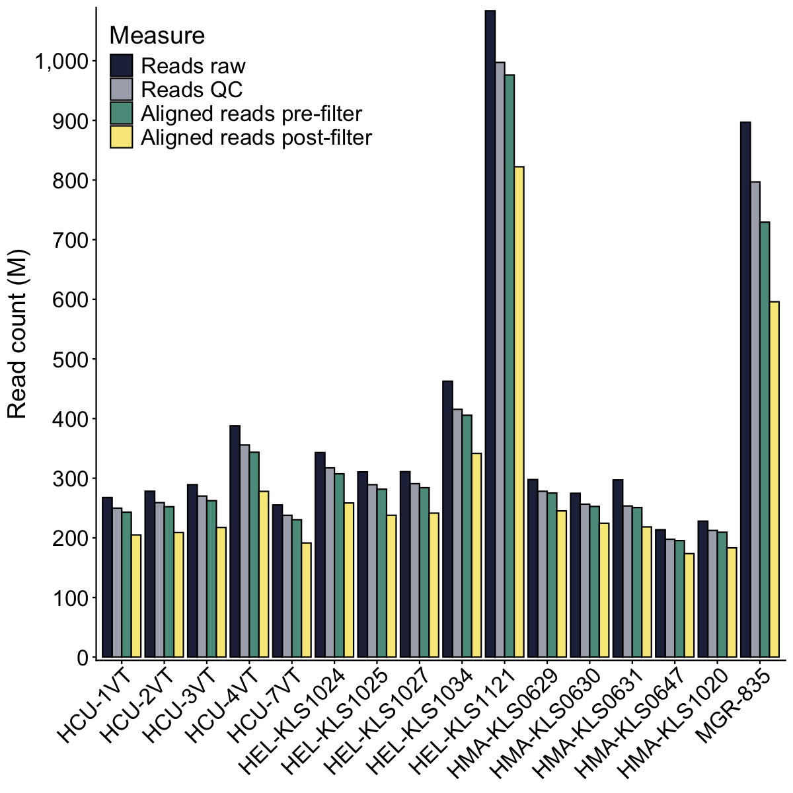

# Alignment and variant calling
Alastair Ludington
2026-09-04

- [Reads and alignments](#reads-and-alignments)
  - [Read statistics](#read-statistics)
  - [Alignment statistics](#alignment-statistics)
  - [Depth of coverage statistics](#depth-of-coverage-statistics)
    - [Reference matched](#reference-matched)
    - [Common reference](#common-reference)
    - [Data loss (supp. figure)](#data-loss-supp-figure)
- [Variant calling](#variant-calling)
  - [Reference matched](#reference-matched-1)
  - [Common reference](#common-reference-1)
  - [Masked](#masked)

Alignment and variant calling results.

# Reads and alignments

## Read statistics

Read statistics calculated on the raw FASTQ files and the post-QC FASTQ
files. Read counts generated by the program `seqkit`.

``` r
# Import seqkit read-statistic tables
reads_raw_trim <- dir_ls(path = here("results", "01-alignment-variants", "reads")) |>
    imap(\(x, i)
         read_table(x, col_types = cols()) |> 
             mutate(Condition = str_remove(basename(i), '-.*'))
    ) |>
    list_rbind() |>
    mutate(file = str_remove(file, '_R.*')) |>
    select(Condition, Sample = file, num_seqs) |>
    summarise(num_seqs = sum(num_seqs), .by = c(Condition, Sample)) |>
    pivot_wider(names_from = Condition, values_from = num_seqs) |>
    filter(!is.na(trimmed))
```

## Alignment statistics

Alignment statistics are obtained from `samtools flagstat`, which is a
step in the alignment pipeline. Specifically, `flagstat` is run before
and after applying alignment filters.

``` r
# Helper function to parse flagstat files
parseFlagstat <- function(x) {
    nm <- str_remove(basename(x), pattern = '-pre.flagstat|-post.flagstat')
    when <- sub('.+-(.*).flagstat', '\\1', basename(x))
    
    # Parse properly paired alignment information
    f <- read_lines(x)
    pp <- grep(pattern = "properly paired", x = f, value = TRUE)
    pp.count <- as.numeric(str_split(string = pp, pattern = ' ', simplify = TRUE)[[1]]) # Number
    
    # return tibble
    tibble(
        Sample = nm,
        Condition = when,
        nReads = pp.count
    )
}

# Alignment against common reference (H. major)
alignment_common <- dir_ls(
    path = here("results", "01-alignment-variants", "alignment", "aligned-HMA", "flagstat"), 
    glob = '*.flagstat', 
    recurse = TRUE
) |>
    map(parseFlagstat) |>
    list_rbind() |>
    pivot_wider(names_from = Condition, values_from = nReads) |>
    select(Sample, `Pre-filtering` = pre, `Post-filtering` = post)

# Alignment against respective reference genomes
alignment_matched <- dir_ls(
    path = here("results", "01-alignment-variants", "alignment", "aligned-matched", "flagstat"), 
    glob = '*.flagstat', 
    recurse = TRUE
) |>
    map(parseFlagstat) |>
    list_rbind() |>
    pivot_wider(names_from = Condition, values_from = nReads) |>
    select(Sample, `Pre-filtering` = pre, `Post-filtering` = post)
```

## Depth of coverage statistics

Depth of coverage was obtained using `mosdepth`. We estimated coverage
for species-matched and common-reference datasets

``` r
cov_matched <- dir_ls(path = here("results", "01-alignment-variants", "alignment", "aligned-matched", "mosdepth")) |>
    read_tsv(id = 'Sample', col_types = cols()) |>
    filter(chrom == 'total') |>
    select(Sample, mean) |>
    mutate(Sample = str_remove(basename(Sample), '\\..*')) |>
    rename(`Mean coverage` = mean)

# Note H. major samples will have the same values as the table above
cov_common <- dir_ls(path = here("results", "01-alignment-variants", "alignment", "aligned-hma", "mosdepth")) |>
    read_tsv(id = 'Sample', col_types = cols()) |>
    filter(chrom == 'total') |>
    select(Sample, mean) |>
    mutate(Sample = str_remove(basename(Sample), '\\..*')) |>
    rename(`Mean coverage` = mean)
```

### Reference matched

The table below shows data loss from sequencing to quality-filtered
alignments after aligning samples to their respective reference genomes.
All percentages are calculated using the raw total to reflect the total
amount of data loss.

These data are used for:

- SFS
- PSMC’

``` r
# Join with read data and adapt column names slightly
ref_matched_stats <- list(reads_raw_trim, alignment_matched, cov_matched) |>
    reduce(left_join) |>
    rename(
        `Reads raw` = raw,
        `Reads QC` = trimmed,
        `Aligned reads pre-filter` = `Pre-filtering`,
        `Aligned reads post-filter` = `Post-filtering`
    ) |>
    mutate(
        `Reads QC (%)` = `Reads QC`/`Reads raw` * 100,
        `Aligned reads pre-filter (%)` = `Aligned reads pre-filter`/`Reads raw` * 100,
        `Aligned reads post-filter (%)` = `Aligned reads post-filter`/`Reads raw` * 100
    ) |>
    select(
        Sample, `Reads raw`,
        `Reads QC`, `Reads QC (%)`,
        `Aligned reads pre-filter`, `Aligned reads pre-filter (%)`,
        `Aligned reads post-filter`, `Aligned reads post-filter (%)`,
        `Mean coverage`
    ) |>
    # This sample doesn't have a reference genome, so can ignore from this table
    filter(Sample != "MGR-835")

write_csv(
    ref_matched_stats,
    file = here("manuscript", "tables", "supplementary", "reads-alignment-stats-reference-matched.csv")
)

ref_matched_stats |>
    gt::gt(rowname_col = "Sample") |>
    gt::fmt_number(columns = contains("%"), decimals = 1) |>
    gt::fmt_number(columns = `Mean coverage`, decimals = 1) |>
    gt::fmt_number(columns = !contains("%"), use_seps = TRUE, drop_trailing_zeros = TRUE) |>
    gt::cols_align(columns = 2:8, align = "center") |>
    gt::tab_style(
        style = gt::cell_text(weight = "bold"),
        locations = gt::cells_column_labels(everything())
    ) |>
    gt::as_raw_html()
```

<div id="sepzucvxbf" style="padding-left:0px;padding-right:0px;padding-top:10px;padding-bottom:10px;overflow-x:auto;overflow-y:auto;width:auto;height:auto;">
  &#10;  

|  | Reads raw | Reads QC | Reads QC (%) | Aligned reads pre-filter | Aligned reads pre-filter (%) | Aligned reads post-filter | Aligned reads post-filter (%) | Mean coverage |
|:---|:--:|:--:|:--:|:--:|:--:|:--:|:--:|---:|
| HCU-1VT | 267,586,314 | 249,808,162 | 93.4 | 245,724,658 | 91.8 | 216,617,855 | 81.0 | 16.5 |
| HCU-2VT | 278,164,778 | 259,019,694 | 93.1 | 254,348,152 | 91.4 | 220,737,699 | 79.4 | 16.73 |
| HCU-3VT | 289,188,448 | 270,066,406 | 93.4 | 264,789,746 | 91.6 | 229,733,049 | 79.4 | 17.42 |
| HCU-4VT | 387,932,328 | 355,716,264 | 91.7 | 346,730,436 | 89.4 | 295,071,532 | 76.1 | 21.92 |
| HCU-7VT | 255,169,496 | 237,797,988 | 93.2 | 232,877,686 | 91.3 | 202,636,596 | 79.4 | 15.4 |
| HEL-KLS1024 | 343,009,608 | 317,305,754 | 92.5 | 310,799,158 | 90.6 | 276,194,777 | 80.5 | 20.84 |
| HEL-KLS1025 | 310,601,808 | 289,153,862 | 93.1 | 285,036,352 | 91.8 | 254,553,438 | 82.0 | 19.26 |
| HEL-KLS1027 | 310,971,320 | 290,825,834 | 93.5 | 287,746,526 | 92.5 | 257,840,045 | 82.9 | 19.54 |
| HEL-KLS1034 | 462,669,448 | 415,463,134 | 89.8 | 410,638,262 | 88.8 | 364,921,124 | 78.9 | 27.45 |
| HEL-KLS1121 | 1,083,815,782 | 997,195,570 | 92.0 | 988,758,952 | 91.2 | 887,314,711 | 81.9 | 65.78 |
| HMA-KLS0629 | 297,733,702 | 278,099,610 | 93.4 | 275,213,204 | 92.4 | 245,153,649 | 82.3 | 18.25 |
| HMA-KLS0630 | 274,748,352 | 256,435,026 | 93.3 | 252,676,796 | 92.0 | 224,462,851 | 81.7 | 16.71 |
| HMA-KLS0631 | 297,168,064 | 253,449,224 | 85.3 | 250,803,256 | 84.4 | 218,289,061 | 73.5 | 16 |
| HMA-KLS0647 | 213,580,724 | 197,635,582 | 92.5 | 195,328,190 | 91.5 | 173,540,058 | 81.3 | 12.92 |
| HMA-KLS1020 | 227,979,122 | 212,416,560 | 93.2 | 209,411,136 | 91.9 | 183,187,176 | 80.4 | 13.63 |

</div>

### Common reference

The table below shows data loss from sequencing to quality-filtered
alignments after aligning samples to a the common *H. major* reference
genome. All percentages are calculated using the raw total to reflect
the total amount of data loss.

These data are used for all:

- Genome scans (diversity statistics)
- Divergence profiling

``` r
common_ref_stats <- list(reads_raw_trim, alignment_common, cov_common) |>
    reduce(left_join) |>
    rename(
        `Reads raw` = raw,
        `Reads QC` = trimmed,
        `Aligned reads pre-filter` = `Pre-filtering`,
        `Aligned reads post-filter` = `Post-filtering`
    ) |>
    mutate(
        `Reads QC (%)` = `Reads QC`/`Reads raw` * 100,
        `Aligned reads pre-filter (%)` = `Aligned reads pre-filter`/`Reads raw` * 100,
        `Aligned reads post-filter (%)` = `Aligned reads post-filter`/`Reads raw` * 100
    ) |>
    select(
        Sample, `Reads raw`,
        `Reads QC`, `Reads QC (%)`,
        `Aligned reads pre-filter`, `Aligned reads pre-filter (%)`,
        `Aligned reads post-filter`, `Aligned reads post-filter (%)`,
        `Mean coverage`
    )

write_csv(
    common_ref_stats,
    file = here("manuscript", "tables", "supplementary", "reads-alignment-stats-common-reference.csv")
)

common_ref_stats |>
    gt::gt(rowname_col = "Sample") |>
    gt::fmt_number(columns = contains("%"), decimals = 1) |>
    gt::fmt_number(columns = `Mean coverage`, decimals = 1) |>
    gt::fmt_number(columns = !contains("%"), use_seps = TRUE, drop_trailing_zeros = TRUE) |>
    gt::cols_align(columns = 2:8, align = "center") |>
    gt::tab_style(
        style = gt::cell_text(weight = "bold"),
        locations = gt::cells_column_labels(everything())
    ) |>
    gt::as_raw_html()
```

<div id="kqvtvjhwrs" style="padding-left:0px;padding-right:0px;padding-top:10px;padding-bottom:10px;overflow-x:auto;overflow-y:auto;width:auto;height:auto;">
  &#10;  

|  | Reads raw | Reads QC | Reads QC (%) | Aligned reads pre-filter | Aligned reads pre-filter (%) | Aligned reads post-filter | Aligned reads post-filter (%) | Mean coverage |
|:---|:--:|:--:|:--:|:--:|:--:|:--:|:--:|---:|
| HCU-1VT | 267,586,314 | 249,808,162 | 93.4 | 243,036,206 | 90.8 | 204,861,542 | 76.6 | 15.19 |
| HCU-2VT | 278,164,778 | 259,019,694 | 93.1 | 252,184,260 | 90.7 | 208,856,404 | 75.1 | 15.42 |
| HCU-3VT | 289,188,448 | 270,066,406 | 93.4 | 262,324,182 | 90.7 | 217,401,099 | 75.2 | 16.04 |
| HCU-4VT | 387,932,328 | 355,716,264 | 91.7 | 343,548,386 | 88.6 | 277,923,735 | 71.6 | 20.09 |
| HCU-7VT | 255,169,496 | 237,797,988 | 93.2 | 230,433,330 | 90.3 | 191,401,176 | 75.0 | 14.15 |
| HEL-KLS1024 | 343,009,608 | 317,305,754 | 92.5 | 307,360,310 | 89.6 | 258,469,765 | 75.4 | 19.03 |
| HEL-KLS1025 | 310,601,808 | 289,153,862 | 93.1 | 281,608,700 | 90.7 | 237,847,020 | 76.6 | 17.57 |
| HEL-KLS1027 | 310,971,320 | 290,825,834 | 93.5 | 284,105,446 | 91.4 | 241,426,349 | 77.6 | 17.86 |
| HEL-KLS1034 | 462,669,448 | 415,463,134 | 89.8 | 405,580,174 | 87.7 | 341,604,172 | 73.8 | 25.09 |
| HEL-KLS1121 | 1,083,815,782 | 997,195,570 | 92.0 | 976,132,088 | 90.1 | 822,225,177 | 75.9 | 59.48 |
| HMA-KLS0629 | 297,733,702 | 278,099,610 | 93.4 | 275,213,204 | 92.4 | 245,153,649 | 82.3 | 18.25 |
| HMA-KLS0630 | 274,748,352 | 256,435,026 | 93.3 | 252,676,796 | 92.0 | 224,462,851 | 81.7 | 16.71 |
| HMA-KLS0631 | 297,168,064 | 253,449,224 | 85.3 | 250,803,256 | 84.4 | 218,289,061 | 73.5 | 16 |
| HMA-KLS0647 | 213,580,724 | 197,635,582 | 92.5 | 195,328,190 | 91.5 | 173,540,058 | 81.3 | 12.92 |
| HMA-KLS1020 | 227,979,122 | 212,416,560 | 93.2 | 209,411,136 | 91.9 | 183,187,176 | 80.4 | 13.63 |
| MGR-835 | 896,979,132 | 796,714,316 | 88.8 | 729,373,332 | 81.3 | 595,842,321 | 66.4 | 40.74 |

</div>

### Data loss (supp. figure)

Below is a simple bar-plot of the tables above showing the loss in data
after filtering.

``` r
pal <- c('#252B48', '#44506980', '#5B9A8B', '#F7E987')
figure_reads <- common_ref_stats |>
    select(!contains('%')) |>
    pivot_longer(names_to = 'Measure', values_to = 'Counts', 2:5) |>
    mutate(
        Group = "Common",
        Measure = forcats::fct_inorder(Measure)
    ) |>
    ggplot(aes(x = Sample, y = Counts, fill = Measure)) +
    geom_bar(stat = 'identity', position = 'dodge', colour = 'black') +
    scale_y_continuous(
        breaks = breaks_pretty(n = 11),
        labels = label_number(scale = 1e-6, big.mark = ","),
        expand = c(0.005, 0)
    ) +
    scale_fill_manual(values = pal) +
    labs(y = 'Read count (M)') +
    theme_classic() +
    theme(
        axis.title.x = element_blank(),
        axis.text.x = element_text(angle = 45, hjust = 0.98, size = 16),
        axis.text.y = element_text(size = 16),
        axis.title.y = element_text(size = 18),
        legend.position = "inside",
        legend.position.inside = c(0.21, 0.88),
        legend.title = element_text(size = 18),
        legend.text = element_text(size = 16)
    )

ragg::agg_png(
    filename = here("manuscript", "figures", "supplementary", "supp-figure-X-read-loss-common-reference.png"),
    width = 1000, 
    height = 1000,
    units = "px",
    scaling = 1.2
)
figure_reads
invisible(dev.off())

cairo_pdf(
    filename = here("manuscript", "figures", "supplementary", "supp-figure-X-read-loss-common-reference.pdf"), 
    width = 10, height = 8, 
    fallback_resolution = 300
)
figure_reads
invisible(dev.off())

figure_reads
```



# Variant calling

This section is focussed on the variant calling results.

``` r
lvls.order <- c('unfiltered', 'all-samples', 'hma-hcu-hel', 'hcu-hel', 'hcu-hma', 'hel-hma', 'hcu', 'hel', 'hma')
lvls.chr <- paste0(rep('chr', 15), 1:15)
```

The tables below shows the number of sites that were considered for
variant calling in each condition (independent samples, pairs of
samples, all samples etc…), along with the number of variants that were
actually called. These statistics were generated using
`bcftools index -s` and `bcftools +counts` respectively.

## Reference matched

Samples were mapped to their respective reference genomes and variants
were called. These data were used for the MSMC analysis and SFS work. No
masking of chromosome 2 was performed here, as the extent of misassembly
was not identified in the other snake genomes (*H. elegans* and *H.
curtus*).

``` r
matched_called_sites <- dir_ls(
    path = here(
        "results",
        "01-alignment-variants",
        "variants",
        "aligned-matched"
    ),
    glob = '*.index_stats',
    recurse = TRUE
) |>
    read_tsv(
        col_types = cols(),
        col_names = c('chr', 'length', 'called'),
        id = 'sample'
    ) |>
    mutate(sample = str_remove(basename(sample), '.vcf.gz.*')) |>
    arrange(sample) |>
    group_split(sample) |>
    map(\(x) {
        x |>
            janitor::adorn_totals()
    }) |>
    list_rbind() |>
    mutate(
        sample = case_when(
            sample == "HCU" ~ "H. curtus",
            sample == "HEL" ~ "H. elegans"
        )
    )

write_csv(
    matched_called_sites,
    file = here("manuscript", "tables", "supplementary", "supp-number-genotyped-sites-by-chrom-reference-matched.csv")
)
```

The number of called SNPs is below

``` r
matched_snps <- dir_ls(
    path = here(
        "results",
        "01-alignment-variants",
        "variants",
        "aligned-matched"
    ),
    glob = '*.counts_stats',
    recurse = TRUE
) |>
    read_delim(
        delim = ':', 
        col_names = c('Type', 'count'), 
        col_types = cols(), 
        id = 'sample'
    ) |>
    mutate(
        count = str_trim(count),
        count = as.numeric(count),
        sample = str_remove(basename(sample), '.vcf.*')
    ) |>
    arrange(sample) |>
    pivot_wider(names_from = sample, values_from = count) |>
    slice(c(1,2,6))

write_csv(
    matched_snps,
    file = here("manuscript", "tables", "supplementary", "supp-number-snps-reference-matched.csv")
)
```

## Common reference

``` r
called_sites <- dir_ls(
    path = here(
        "results",
        "01-alignment-variants",
        "variants",
        "aligned-HMA",
        "stats"
    ),
    glob = '*.index_stats'
) |>
    read_tsv(
        col_types = cols(),
        col_names = c('chr', 'length', 'called'),
        id = 'sample'
    ) |>
    mutate(
        sample = str_remove(basename(sample), '.vcf.gz.*'),
        # sample = factor(sample, levels = lvls.order),
        # chr = factor(chr, levels = lvls.chr)
    ) |>
    arrange(sample) |>
    pivot_wider(names_from = sample, values_from = called) |> 
    janitor::adorn_totals() |>
    select(
        Chromosome = chr,
        Length = length,
        HMA, HEL, HCU, MGR,
        `HCU-HEL`, `HCU-HMA`, `HEL-HMA`,
        `HCU-HEL-HMA`, `HCU-HEL-HMA-MGR`,
        `HCU-HEL-HMA-MGR-biallelic`
    )

called_sites |>
    write_csv(here(
        "manuscript",
        "tables",
        "supplementary",
        "supp-number-genotyped-sites-by-chromosome-no-masking.csv"
    ))

called_sites |>
    gt::gt(rowname_col = "Chromosome") |>
    gt::fmt_number(
        columns = 2:ncol(called_sites),
        use_seps = TRUE,
        drop_trailing_zeros = TRUE
    ) |>
    gt::cols_align(columns = 2:ncol(called_sites), align = "center") |>
    gt::tab_style(
        style = gt::cell_text(weight = "bold"),
        locations = gt::cells_column_labels(everything())
    ) |>
    gt::as_raw_html()
```

<div id="sgeqdbhyvp" style="padding-left:0px;padding-right:0px;padding-top:10px;padding-bottom:10px;overflow-x:auto;overflow-y:auto;width:auto;height:auto;">
  &#10;  

|  | Length | HMA | HEL | HCU | MGR | HCU-HEL | HCU-HMA | HEL-HMA | HCU-HEL-HMA | HCU-HEL-HMA-MGR | HCU-HEL-HMA-MGR-biallelic |
|:---|:--:|:--:|:--:|:--:|:--:|:--:|:--:|:--:|:--:|:--:|:--:|
| chr1 | 434,526,931 | 311,599,672 | 349,237,457 | 318,171,861 | 367,268,657 | 307,761,240 | 275,946,393 | 292,843,604 | 269,147,906 | 258,092,645 | 7,118,257 |
| chr2 | 381,225,800 | 246,793,452 | 274,867,273 | 248,213,682 | 293,279,177 | 237,901,898 | 213,648,152 | 227,060,045 | 207,335,518 | 198,526,464 | 5,479,980 |
| chr3 | 268,276,564 | 184,940,572 | 207,896,107 | 188,959,887 | 220,343,102 | 182,592,471 | 163,281,039 | 173,334,398 | 159,153,923 | 152,565,066 | 4,230,171 |
| chr4 | 218,045,602 | 152,746,588 | 172,881,642 | 156,996,359 | 182,385,059 | 152,067,606 | 135,638,573 | 144,103,172 | 132,490,078 | 126,926,215 | 3,617,766 |
| chr5 | 142,905,876 | 97,378,071 | 111,001,146 | 99,999,389 | 117,436,259 | 96,575,924 | 85,604,272 | 91,264,479 | 83,417,220 | 79,371,332 | 2,256,357 |
| chr6 | 106,938,139 | 69,177,182 | 79,108,242 | 70,955,202 | 85,196,393 | 68,438,784 | 60,510,626 | 64,736,544 | 58,959,389 | 56,529,147 | 1,696,179 |
| chr7 | 42,362,139 | 20,915,223 | 24,196,894 | 22,237,075 | 26,141,647 | 21,561,748 | 19,071,111 | 19,973,277 | 18,709,053 | 18,240,213 | 528,083 |
| chr8 | 34,083,018 | 17,025,362 | 19,902,173 | 18,267,693 | 21,779,332 | 17,794,385 | 15,694,888 | 16,414,775 | 15,445,219 | 15,148,803 | 437,250 |
| chr9 | 30,848,814 | 20,497,424 | 23,799,162 | 21,879,087 | 25,779,433 | 21,228,607 | 18,688,558 | 19,591,620 | 18,322,461 | 17,831,081 | 499,975 |
| chr10 | 28,798,323 | 15,770,337 | 18,452,956 | 16,960,408 | 20,096,055 | 16,564,091 | 14,600,607 | 15,273,316 | 14,397,796 | 14,141,095 | 412,442 |
| chr11 | 28,504,944 | 17,354,881 | 20,307,460 | 18,612,779 | 22,180,010 | 18,129,054 | 15,986,864 | 16,750,564 | 15,725,516 | 15,404,557 | 442,778 |
| chr12 | 23,795,472 | 10,107,228 | 12,354,138 | 10,984,334 | 13,880,590 | 10,386,039 | 8,930,959 | 9,484,402 | 8,690,028 | 8,534,651 | 272,376 |
| chr13 | 19,560,250 | 13,307,042 | 15,716,139 | 14,420,040 | 17,257,532 | 14,070,637 | 12,304,999 | 12,885,725 | 12,126,278 | 11,883,427 | 361,039 |
| chr14 | 16,934,482 | 6,732,130 | 8,369,971 | 7,504,391 | 9,658,343 | 7,267,000 | 6,144,179 | 6,471,815 | 6,044,799 | 5,945,717 | 192,683 |
| chr15 | 16,659,334 | 5,517,956 | 6,525,497 | 5,541,205 | 8,106,283 | 5,113,667 | 4,265,605 | 4,560,608 | 4,085,466 | 4,012,492 | 131,177 |
| Total | 1,793,465,688 | 1,189,863,120 | 1,344,616,257 | 1,219,703,392 | 1,430,787,872 | 1,177,453,151 | 1,050,316,825 | 1,114,748,344 | 1,024,050,650 | 983,152,905 | 27,676,513 |

</div>

The table below is a condensed version of the above, showing the number
of SNPs that were called in addition to the total number of sites.

``` r
snps <- dir_ls(
    path = here(
        "results",
        "01-alignment-variants",
        "variants",
        "aligned-HMA",
        "stats"
    ),
    glob = '*gz.stats'
) |>
    read_delim(
        delim = ':', 
        col_names = c('Type', 'count'), 
        col_types = cols(), 
        id = 'sample'
    ) |>
    mutate(
        count = str_trim(count),
        count = as.numeric(count),
        sample = str_remove(basename(sample), '.vcf.*'),
        # sample = factor(sample, levels = lvls.order)
    ) |>
    arrange(sample) |>
    pivot_wider(names_from = sample, values_from = count) |>
    select(
        Type,
        HMA, HEL, HCU, MGR,
        `HCU-HEL`, `HCU-HMA`, `HEL-HMA`,
        `HCU-HEL-HMA`, `HCU-HEL-HMA-MGR`,
        `HCU-HEL-HMA-MGR-biallelic`
    ) |>
    slice(c(1,2,6))

snps |>
    write_csv(here("manuscript", "tables", "supplementary", "supp-total-number-of-snps.csv"))

snps |>
    gt::gt(rowname_col = "Type") |>
    gt::fmt_number(columns = 2:ncol(snps), use_seps = TRUE, drop_trailing_zeros = TRUE) |>
    gt::cols_align(columns = 2:ncol(snps), align = "center") |>
    gt::tab_style(
        style = gt::cell_text(weight = "bold"),
        locations = gt::cells_column_labels(everything())
    ) |>
    gt::as_raw_html()
```

<div id="fjshzaonno" style="padding-left:0px;padding-right:0px;padding-top:10px;padding-bottom:10px;overflow-x:auto;overflow-y:auto;width:auto;height:auto;">
  &#10;  

|  | HMA | HEL | HCU | MGR | HCU-HEL | HCU-HMA | HEL-HMA | HCU-HEL-HMA | HCU-HEL-HMA-MGR | HCU-HEL-HMA-MGR-biallelic |
|:---|:--:|:--:|:--:|:--:|:--:|:--:|:--:|:--:|:--:|:--:|
| Number of samples | 5 | 5 | 5 | 1 | 10 | 10 | 10 | 15 | 16 | 16 |
| Number of SNPs | 37,415,892 | 41,138,939 | 36,954,053 | 43,411,519 | 34,831,387 | 31,301,730 | 33,573,708 | 29,874,669 | 27,856,517 | 27,676,513 |
| Number of sites | 1,189,863,120 | 1,344,616,257 | 1,219,703,392 | 1,430,787,872 | 1,177,453,151 | 1,050,316,825 | 1,114,748,344 | 1,024,050,650 | 983,152,905 | 27,676,513 |

</div>

## Masked

Below are the statistics after masking chromosome 2 problematic regions.

``` r
# Total called sites - only difference should be chr2
called_sites_clean <- dir_ls(
    path = here(
        "results",
        "01-alignment-variants",
        "variants",
        "aligned-HMA",
        "stats",
        "masked"
    ),
    glob = '*.index_stats'
) |>
    read_tsv(
        col_types = cols(),
        col_names = c('chr', 'length', 'called'),
        id = 'sample'
    ) |>
    mutate(
        sample = str_remove(basename(sample), '-clean.vcf.gz.*'),
        # sample = factor(sample, levels = lvls.order),
        # chr = factor(chr, levels = lvls.chr)
    ) |>
    arrange(sample) |>
    pivot_wider(names_from = sample, values_from = called) |> 
    janitor::adorn_totals() |>
    select(
        Chromosome = chr,
        Length = length,
        `HCU-HEL`, `HCU-HMA`, `HEL-HMA`,
        `HCU-HEL-HMA-MGR-biallelic`
    )

# Cleaned SNP totals
snps_clean <- dir_ls(
    path = here(
        "results",
        "01-alignment-variants",
        "variants",
        "aligned-HMA",
        "stats",
        "masked"
    ),
    glob = '*gz.counts_stats'
) |>
    read_delim(
        delim = ':', 
        col_names = c('Type', 'count'), 
        col_types = cols(), 
        id = 'sample'
    ) |>
    mutate(
        count = str_trim(count),
        count = as.numeric(count),
        sample = str_remove(basename(sample), '-clean.vcf.*'),
        # sample = factor(sample, levels = lvls.order)
    ) |>
    arrange(sample) |>
    pivot_wider(names_from = sample, values_from = count) |>
    select(
        Type,
        `HCU-HEL`, `HCU-HMA`, `HEL-HMA`,
        `HCU-HEL-HMA-MGR-biallelic`
    ) |>
    slice(c(1,2,6))

called_sites_clean |>
    write_csv(here(
        "manuscript",
        "tables",
        "supplementary",
        "supp-number-genotyped-sites-by-chromosome-masked.csv"
    ))

snps_clean |>
    write_csv(here("manuscript", "tables", "supplementary", "supp-total-number-of-snps-clean.csv"))
```
