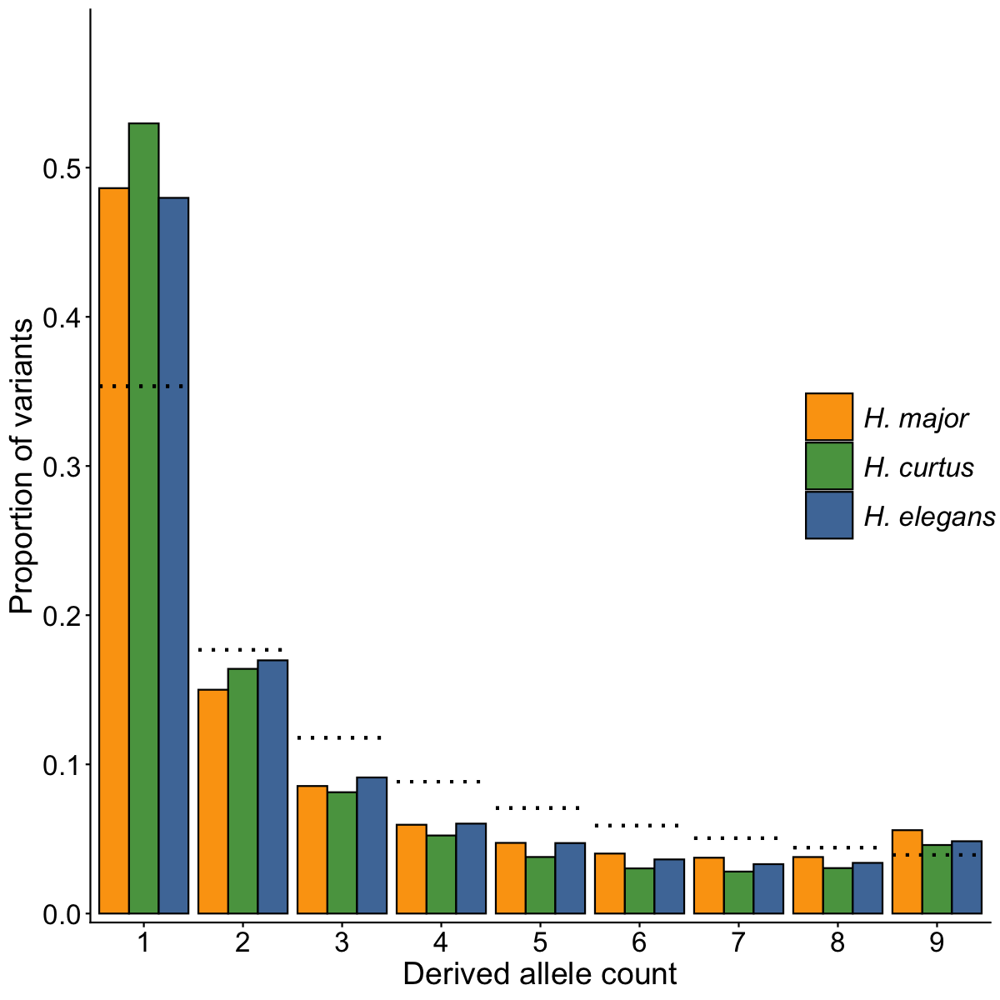
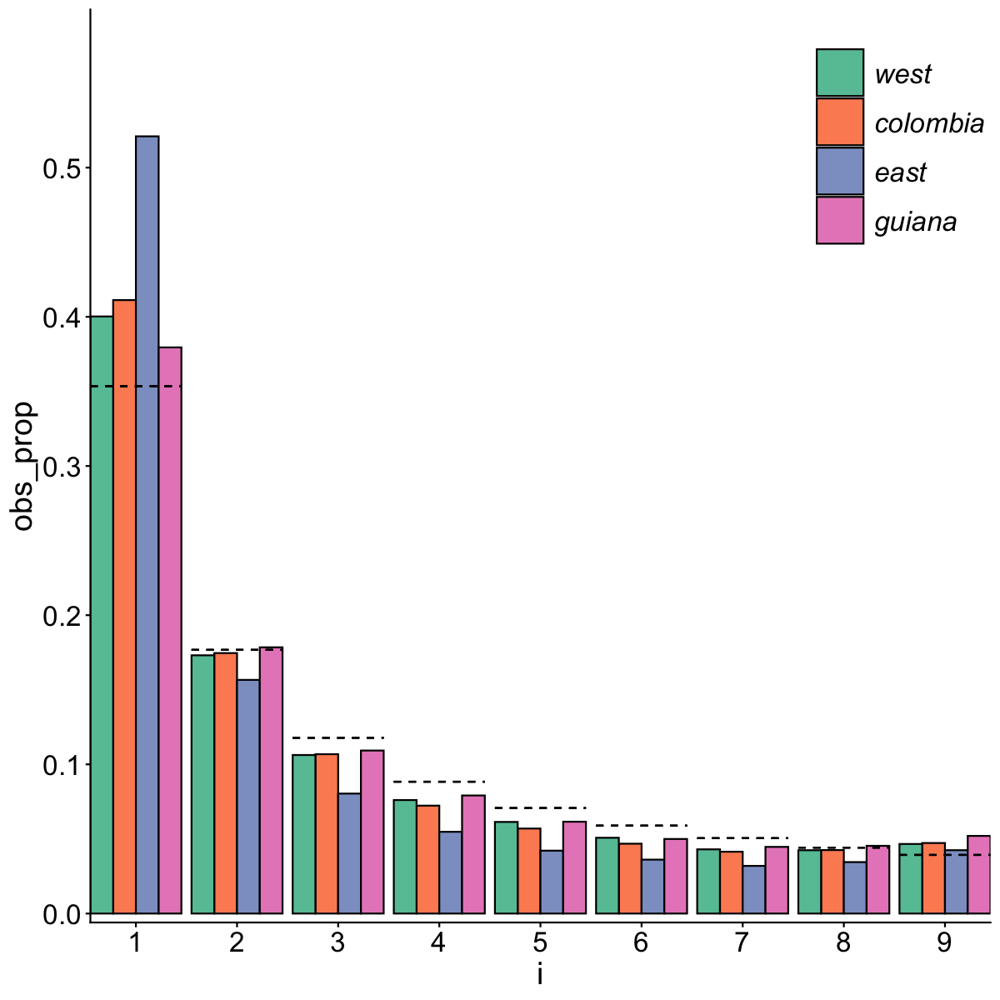
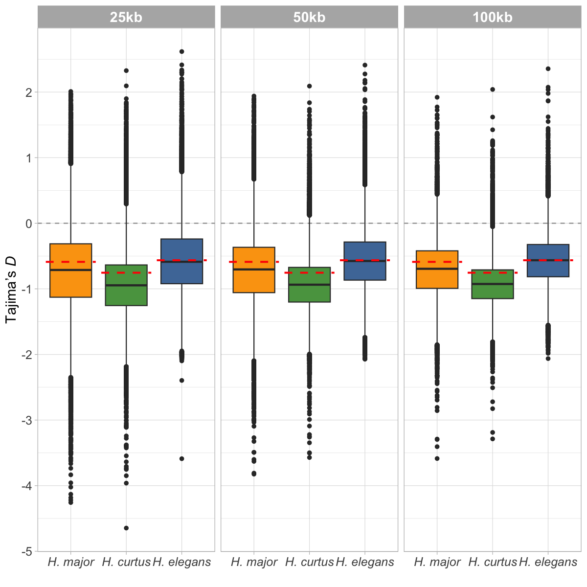
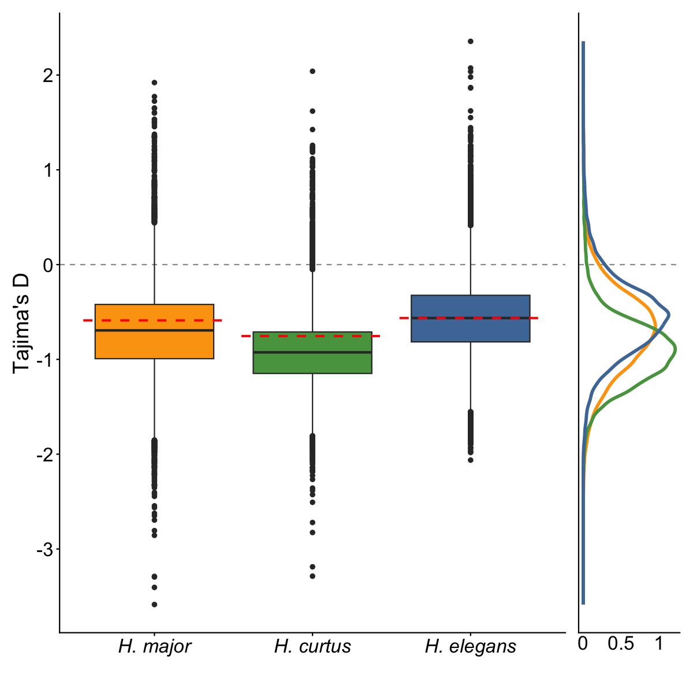
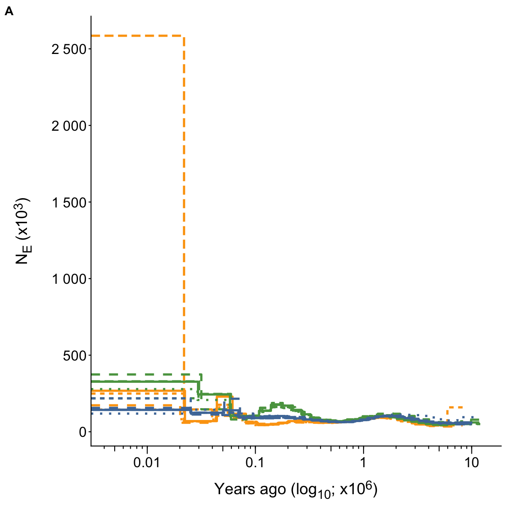
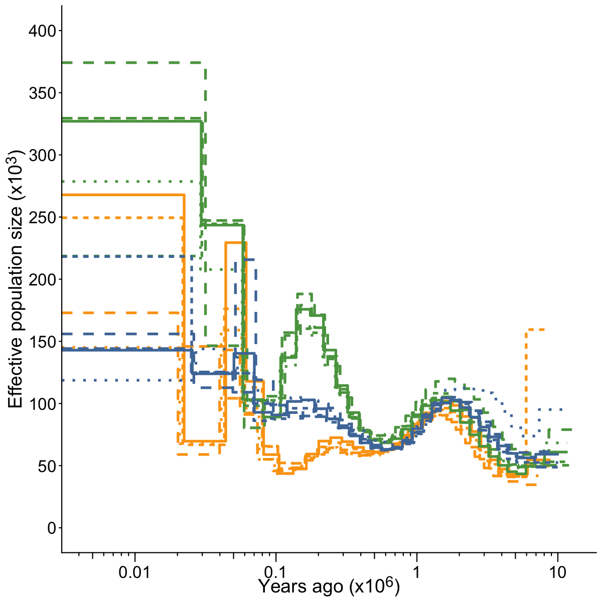
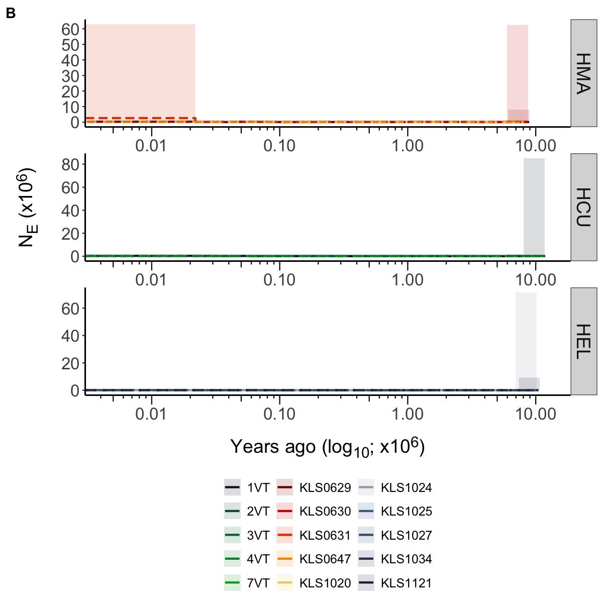
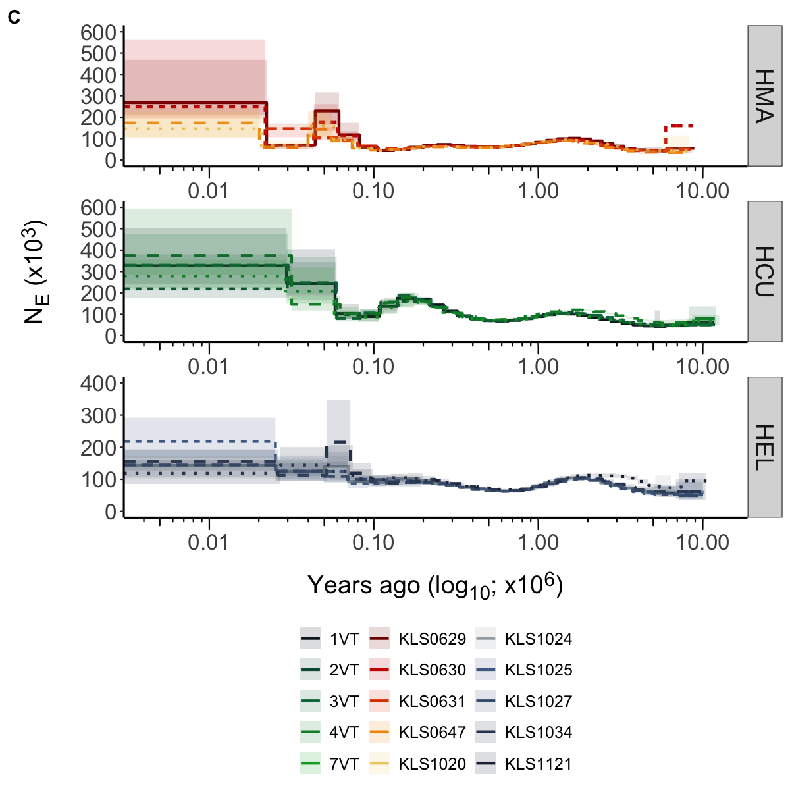
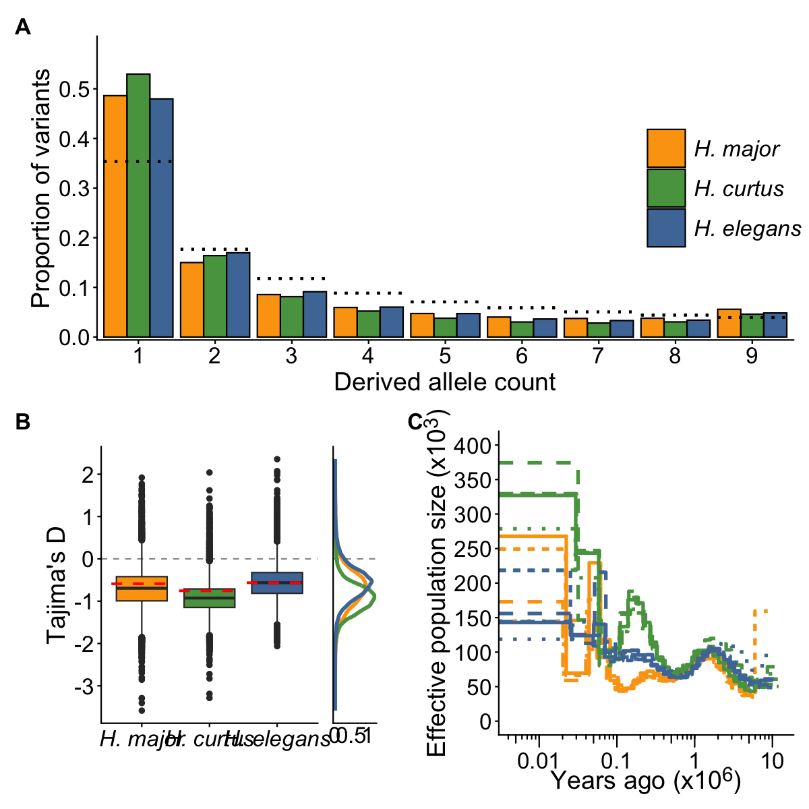

# Demography
Alastair Ludington
2026-09-05

- [SFS](#sfs)
  - [Unfolded SFS](#unfolded-sfs)
  - [Validation](#validation)
- [Tajimas D](#tajimas-d)
  - [Genome-wide estimate](#genome-wide-estimate)
  - [Sliding window estimate](#sliding-window-estimate)
- [Effective population size (Ne)](#effective-population-size-ne)
- [Create supplementary figure](#create-supplementary-figure)
- [Create main-text figure](#create-main-text-figure)

Here we’ll go through the SFS and MSMC2 results.

## SFS

Separate 1D-SFS were produced separately for each species. The
high-confidence sites (both variant and invariant) were passed to
`angsd` using the `-sites` argument, with a range of other `angsd`
filters.

The `.saf` files produced by `angsd` were then passed to `realSFS` to
produce the SFS. 50 bootstraps were produced for each species. This
script calculates the average and standard deviation for each column.

Some pages that I used for assistance:

- [This
  tutorial](https://eriqande.github.io/coalescent-hands-on/004-one-dimensional-SFS.nb.html)
  for the calculations
- Formula for expected counts under the standard neutral model ([Fu
  1995](doi:10.1006/tpbi.1995.1025))

``` r
# This code is built from the tutorial above
helper <- function(path) {
    sfs <- read_delim(
        path, 
        delim = " ", 
        col_names = FALSE, 
        col_types = cols()
    ) |>
        select(-X1, -X11, -X12)
    sfs_mean <- colMeans(sfs)
    sfs_sd <- apply(sfs, 2, sd)
    
    # Calculate expected SFS
    nSNPs <- sum(sfs_mean)
    fracts <- 1/1:length(sfs_mean)
    Sin <- (nSNPs * fracts) / sum(fracts) # Normalize then multiply by the number of SNPs
    
    # Expected
    df.exp <- tibble(
        i = 1:length(sfs_mean),
        exp_count = Sin
    ) %>%
        mutate(exp_prop = exp_count / nSNPs)
    
    # Obvserved
    df.obs <- tibble(
        i = 1:9,
        obs_count = sfs_mean,
        obs_sd = sfs_sd
    ) %>%
        mutate(obs_prop = obs_count / nSNPs)
    
    left_join(df.obs, df.exp) |>
        mutate(Species = str_remove(basename(path), '-50-bootstrap.sfs'))
}
```

### Unfolded SFS

Below I load each SFS file for the three species and apply the helper
function above. The data are then stored in a long-format data-frame for
plotting below.

``` r
# Ordering levels
lvls <- c("H. major", "H. curtus", "H. elegans")

sfs <- dir_ls(path = here("results", "02-demography", "sfs", "ref-matched"), glob = "*.sfs") |>
    (\(x) set_names(x, nm = str_remove(basename(x), "-50.*")))() |>
    map(helper) |>
    list_rbind()  |>
    # Using actual species names as I extract the legend for the patchwork plot
    mutate(
        Species = toupper(Species),
        Species = case_when(
            Species == "HMA" ~ "H. major",
            Species == "HEL" ~ "H. elegans",
            Species == "HCU" ~ "H. curtus"
        ),
        Species = factor(Species, levels = lvls)
    )

# Figure
plot_sfs <- sfs |>
    ggplot(aes(x = i, y = obs_prop, fill = Species)) +
    geom_bar(stat = "identity", position = 'dodge', colour = 'black') +
    geom_segment(
        aes(
            x = as.numeric(i) - .45, xend = as.numeric(i) + .45,
            y = exp_prop, yend = exp_prop
        ),
        colour = 'black',
        linetype = 'dotted',
        linewidth = 0.9
    ) +
    labs(
        x = 'Derived allele count',
        y = 'Proportion of variants'
    ) +
    scale_x_continuous(expand = c(0.01,0), breaks = 1:9) +
    scale_y_continuous(
        expand = c(0.01, 0),
        limits = c(0, 0.6),
        breaks = seq(0, 0.5, 0.1)
    ) +
    scale_fill_manual(values = pal_within_long) +
    theme_classic() +
    theme(
        axis.text = element_text(size = 16),
        axis.title = element_text(size = 18),
        legend.text = element_text(size = 16,face = "italic"),
        legend.title = element_blank(),
        legend.position = "inside",
        legend.position.inside = c(0.9, 0.5),
        legend.key.size = unit(1, "cm")
    )

plot_sfs
```



The dashed lines represent the expected allele-frequency for each class
under the standard neutral model. We can see that there is an excess of
singletons with other allele classes being lower than expected.

### Validation

I’ve used data from Simon Martin’s [2016
paper](https://doi.org/10.1534/genetics.115.183285) to validate the code
here. Essentially, I’m loading their 4D data using my code above and
plotting it. I then checked if what I generated is the same as what’s in
Figure 2B in the manuscript.

> NOTE: I’ve not uploaded their data here, but you can access the files
> from the supplementary data attached to the manuscript.

``` r
helper2 <- function(sfs, nm) {
    # S. Martin data is in CSV format, so have edited the function to accommodated CSV input
    
    # Calculate expected SFS
    nSNPs <- sum(sfs) # Removing homozygous ALT as they're not variable
    fracts <-  1 / 1:9 # Unnormalised fractions
    Sin <- nSNPs * fracts / sum(fracts) # Normalize then multiply by the number of SNPs
    
    # Expected
    df.exp <- tibble(
        i = 1:9,
        exp_count = Sin
    ) %>%
        mutate(exp_prop = exp_count / nSNPs)
    
    # Obvserved
    df.obs <- tibble(
        i = 1:9,
        obs_count = sfs
    ) %>%
        mutate(obs_prop = obs_count / nSNPs)
    
    left_join(df.obs, df.exp) |>
        mutate(Species = sub('.+autoScafs\\.(.*).sample5.+', '\\1', basename(nm)))
}
```

The figure below matches Figure 2B from the manuscript identically (not
the colours). Consequently, we’re happy that the code above is doing the
right thing.

``` r
dir_ls(path = here("results", "02-demography", "sfs", "example_data"), glob = "*4D*sample5*.csv") |>
    magrittr::extract(c(2, 4, 6, 8)) |>
    map(\(x) {
        sfs <- x |>
            read_csv(col_types = cols()) |>
            filter(!is.na(sites)) |>
            pull(sites)
    }) |>
    imap(\(x, y) { helper2(x, y)}) |>
    list_rbind() |>
    mutate(
        i = factor(i, levels = 1:9),
        Species = factor(Species, levels = c('west', 'colombia', 'east', 'guiana'))
    ) |>
    ggplot(
        aes(x = i, y = obs_prop, fill = Species)
    ) +
    geom_bar(position = 'dodge', stat = 'identity', colour = 'black') +
    geom_segment(
        aes(
            x = as.numeric(i) - .45, 
            xend = as.numeric(i) + .45,
            y = exp_prop, yend = exp_prop
        ), 
        colour = 'black', 
        linetype = 'dashed'
    ) +
    scale_x_discrete(expand = c(0.01,0)) +
    scale_y_continuous(
        expand = c(0.01, 0),
        limits = c(0, 0.6),
        breaks = seq(0, 0.5, 0.1)
    ) +
    scale_fill_brewer(palette = "Set2") +
    theme_classic() +
    theme(
        axis.text = element_text(size = 16),
        axis.title = element_text(size = 18),
        legend.text = element_text(size = 16,face = "italic"),
        legend.title = element_blank(),
        legend.position = "inside",
        legend.position.inside = c(0.9, 0.85),
        legend.key.size = unit(1, "cm")
    )
```



## Tajimas D

Tajima’s *D* values were calculated from the reference matched VCF files
using `pixy`. Genome-wide estimates were also estimated from the SFS
data above.

Importantly, data were filtered for completeness **only**. No filtering
was applied based on minor allele frequency (MAF) or minor allele count
(MAC).

### Genome-wide estimate

First, we have the genome-wide estimate of Tajima’s *D* estimated from
the SFS tables. I use an excellent package `sfsr` to perform the
calculation.

``` r
sfs_tajD <- dir_ls(path = here("results", "02-demography", "sfs", "ref-matched"), glob = "*.sfs") |>
    (\(x) set_names(x, nm = str_remove(basename(x), "-50.*")))() |>
    map(sfsr::read_sfs, dims = 10, boostraps = TRUE) |>
    map(sfsr::tajimaD) |>
    as_tibble() |>
    colMeans()
```

### Sliding window estimate

Below are the sliding-window estimates of Tajima’s *D* generated by
`pixy` as boxplots. Estimates were generated in a range of window sizes
to assess impact. Windows were filtered on the number of sites used to
estimate the statistic, requiring at least 10% of sites to be called.

``` r
# Load the data
df_tajD <- dir_ls(
    path = here("results", "02-demography", "tajimaD"),
    glob = "*tajima_d.txt"
) |>
    read_tsv(col_types = cols(), id = "file") |>
    mutate(
        file = str_extract(file, "100kb|50kb|25kb"),
        pop = case_when(
            pop == "HMA" ~ "H. major",
            pop == "HEL" ~ "H. elegans",
            pop == "HCU" ~ "H. curtus"
        ),
        pop = factor(pop, levels = lvls),
        int = as.numeric(pop)
    ) |>
    (\(x) split(x, x$file))() |>
    imap(\(x,i) {
        if(i == "100kb") {
            x |> filter(no_sites >= 1e4)
        } else if(i == "50kb") {
            x |> filter(no_sites >= 5e3)
        } else {
            x |> filter(no_sites >= 2.5e3)
        }
    }) |>
    list_rbind()
```

Below we inspect how Tajima’s *D* varies across window sizes. It’s
evident that window size doesn’t drastically impact the overall pattern
of negative Tajima’s *D* across the genome.

``` r
df_sfs_tajD <- tibble(
    pop = names(sfs_tajD),
    gw_tajD = sfs_tajD
) |>
    mutate(
        pop = case_when(
            pop == "HMA" ~ "H. major",
            pop == "HEL" ~ "H. elegans",
            pop == "HCU" ~ "H. curtus"
        ),
        pop = factor(pop, levels = lvls),
        i = as.numeric(pop)
    )

df_sfs_tajD |> 
    select(-i) |> 
    write_csv(here("data", "sfs-tajD-genome-avg.csv"))

taj_levels <- c("25kb", "50kb", "100kb")
plot_tajD_window_size <- df_tajD |>
    mutate(file = factor(file, levels = taj_levels)) |>
    ggplot(
        aes(
            x = factor(int),
            y = tajima_d,
            fill = pop
        )
    ) +
    geom_hline(yintercept = 0, linetype = "dashed", colour = "grey60") +
    geom_boxplot(colour = "grey20") +
    geom_segment(
        data = df_sfs_tajD,
        aes(
            x = as.numeric(i) - .45, xend = as.numeric(i) + .45,
            y = gw_tajD, yend = gw_tajD
        ),
        colour = 'red',
        linetype = 'dashed',
        linewidth = 0.9
    ) +
    scale_x_discrete(
        labels = c(
            "1" = "H. major",
            "2" = "H. curtus",
            "3" = "H. elegans")
    ) +
    scale_y_continuous(
        breaks = scales::pretty_breaks(n = 6)
    ) +
    scale_fill_manual(values = pal_within_long) +
    labs(
        y = "Tajima's *D*",
        x = ""
    ) +
    facet_wrap(vars(file)) +
    theme_light() +
    theme(
        axis.title.y = element_markdown(size = 14),
        axis.text.x = element_text(face = "italic", size = 12),
        axis.text.y = element_text(size = 12),
        
        strip.text = element_text(size = 14, face = "bold"),
        
        
        legend.position = 'none'
    )

agg_png(
    filename = here(
        "manuscript", 
        "figures", 
        "supplementary", 
        "supp-figure-X-tajimas_D-window-sizes.png"
    ),
    width = 1000,
    height = 800,
    units = "px",
    scaling = 1.3
)
plot_tajD_window_size
invisible(dev.off())
plot_tajD_window_size
```



Then we generate the figure. I’ve overlaid the genome-wide estimate in
the box-plot as a red dotted line to show the difference between the two
approaches. I’ve also made a density plot to go along the side to assist
in visualising the distribution of windowed estimates, ensuring there
are no odd distributions.

``` r
plot_box <- df_tajD |>
    filter(file == "100kb") |>
    ggplot(
        aes(
            x = factor(int),
            y = tajima_d,
            fill = pop
        )
    ) +
    geom_hline(yintercept = 0, linetype = "dashed", colour = "grey60") +
    geom_boxplot(colour = "grey20") +
    geom_segment(
        data = df_sfs_tajD,
        aes(
            x = as.numeric(i) - .45, xend = as.numeric(i) + .45,
            y = gw_tajD, yend = gw_tajD
        ),
        colour = 'red',
        linetype = 'dashed',
        linewidth = 0.9
    ) +
    scale_x_discrete(
        labels = c(
            "1" = "H. major",
            "2" = "H. curtus",
            "3" = "H. elegans")
    ) +
    scale_y_continuous(
        breaks = scales::pretty_breaks(n = 6)
    ) +
    scale_fill_manual(values = pal_within_long) +
    labs(x = "") +
    theme_classic() +
    theme(
        axis.text.x = element_text(face = "italic"),
        legend.position = 'none'
    )

# Density plot
plot_density <- df_tajD |>
    filter(file == "100kb") |>
    ggplot(
        aes(
            y = tajima_d,
            colour = pop
        )
    ) +
    geom_hline(yintercept = 0, linetype = "dashed", colour = "grey60") +
    geom_density(linewidth = 1.3) +
    labs(x = 'Density') +
    scale_x_continuous(breaks = c(0, 0.5, 1), labels = c('0', '0.5', '1')) +
    scale_colour_manual(values = pal_within_long) +
    theme_classic() +
    theme(
        legend.position = 'none',
        axis.text.y = element_blank(),
        axis.title.x = element_blank(),
        axis.ticks = element_blank(),
        axis.text = element_text(size = 16)
    )

# Stitch the Density and boxplot together
plot_box_density <- plot_box + plot_density +
    plot_layout(
        widths = c(1, 0.2),
        axes = "collect", axis_titles = "collect",
        guides = 'collect'
    ) &
    labs(y = "Tajima's D") &
    theme(
        axis.title = element_text(size = 18),
        axis.text = element_text(size = 16),
        # legend.position = 'none'
    )

plot_box_density
```



## Effective population size (Ne)

Lastly, we’ll visualise the estimates of historical effective population
size ($\text{N}_\text{e}$) through time. We generated per-sample
estimates using the program `MSMC2` using a custom clock of
4\*1+25\*2+1\*4+1\*6. We’re using four segments in the recent time
interval to try and avoid elevated *N<sub>E</sub>* in recent time
periods.

To scale the results, we need a mutation rate and generation time. We
can estimate the mutation rate using a few bits of data and some basic
equations.

``` r
n_snp <- 43411519 # number of snps
n_total <- 1430787872 # total sites called
```

Equation 1: Jukes Cantor correction

$$d = -\frac{3}{4}ln\left(1 - \frac{4}{3}p\right)$$

Where $p$ is the proporiton of different sites (i.e. SNPs/Total sites).
We mapped *M. gracillis* to the *H. major* reference genome and called
variant and invariant SNPs. The total number of variable sites was
4.3411519^{7} from 1.4307879^{9} total sites.

``` r
p <- n_snp/n_total # SNPs/Total compared sites - these are the highQ positions (depth min(10x), max(2 * Avg)) 
d <- -(3/4) * log(1 - (4/3) * p)
```

Using the equation above, we end up with $d=$ 0.0309718.

Here, we can work out the mutation rate assuming a divergence time
between Hydrophis and Microcelphalophis of ~12mya based on Lee et
al. (2016).

equation 2: molecular clock (Kimura 1968,1983).

$$d=2\mu t$$ Where $\mu$ is the mutation rate and $t$ is the time since
divergence.

``` r
# d=2μt Motoo Kimura (1968, 1983).
div_time <- 12e6
gen <- 5 # Kishida et al. 2019
mu <- d/(2 * div_time) # per-site/per-year
mu_gen <- mu * gen # per-site/per-generation
```

Rearranging the equation, we end up with $\mu=$ 1.2904907^{-9}
per-site/per-year. Multiplying by the generation time, we end up with
$\mu_{gen}=$ 6.4524535^{-9} per-site/per-generation.

For the calculation above, we use a generation time of 10 for Hydrophis
sea snakes. Generation time should be viewed as an average, rather than
the onset of sexual maturity. Generations of 5y are often used, however
longer intervals may be more suitable.

``` r
lvls <- c("HMA", "HCU", "HEL")
clock <- "1*4+1*3+25*2+1*4+1*6"

# Load msmc output files
df_msmc <- dir_ls(
    path = here( "results", "02-demography", "msmc", "custom-clock"),
    glob = '*bootstrap*',
    invert = TRUE,
    recurse = TRUE
) |>
    read_tsv(col_names = TRUE, col_types = cols(), id = 'tmp') |>
    mutate(
        tmp = str_remove(basename(tmp), "-clock1-msmc.txt.final.txt"),
        clock = clock,
        # Scale x-axis: Scaled units > generations (divide by mu_g) > years (mult. generations)
        Years = left_time_boundary/mu_gen*gen,
        # Scale coalescent rate by 1) take inverse 2) divide by mu_g
        Ne = 1/lambda/(2*mu_gen)
    ) |>
    separate(col = tmp, into = c("Species", 'sample'), sep = "-") |>
    mutate(Species = factor(x = Species, lvls))

# Dummy column for linetype
df_dummy <- df_msmc |>
    select(Species, sample) |>
    distinct() |>
    mutate(lt = rep(LETTERS[1:5], 3))

df_msmc <- df_msmc |>
    left_join(df_dummy)
```

First, a plot without any filtering. This is to see how extreme the
recent and distant time points are. We can see that *H. major* sample
`KLS0631` has exceptionally high estimates of N<sub>E</sub> in the
recent time intervals.

This is not uncommon, and is reassuring that it’s occurring in the
recent time intervals. The rest of the curve for sample `KLS0631` plots
nicely and follows the other *H. major* samples. We’ll filter out time
intervals with N<sub>E</sub> \> 500k from the final figure and report
that we’ve had to remove time indicies 0-3 for clarity of visualisation.

``` r
plot_msmc_no_filter <- df_msmc |>
    ggplot(aes(x = Years, y = Ne, colour = Species, linetype = lt)) +
    geom_step(linewidth = 1.2) +
    annotation_logticks(sides = 'b', outside = TRUE) +
    coord_cartesian(clip = "off" ) +
    scale_x_log10(
        labels = scales::label_number(
            scale = 1e-6,
            accuracy = 0.01,
            drop0trailing = TRUE
        )
    ) +
    scale_y_continuous(
        labels = scales::label_number(scale = 1e-3),
        breaks = scales::pretty_breaks(n = 10)
    ) +
    labs(
        y = "N<sub>E</sub> (x10<sup>3</sup>)<br>",
        x = "<br>Years ago (log<sub>10</sub>; x10<sup>6</sup>)",
        tag = "A"
    ) +
    scale_colour_manual(values = pal_within) +
    guides(linetype = 'none') +
    theme_classic() +
    theme(
        axis.title.x = element_markdown(size = 18),
        axis.title.y = element_markdown(size = 18),
        axis.text = element_text(size = 16),
        axis.text.x = element_text(vjust = -1.2),
        strip.text = element_text(size = 18),
        legend.position = "none", 
        
        plot.tag = element_text(face = "bold", size = 14)
    )

plot_msmc_no_filter
```



Here we make the figure that will be used in the main text. We’ve
applied a y-lim to remove the spurious signal in the recent time points
from sample `KLS0631`.

``` r
plot_msmc <- df_msmc |>
    ggplot(aes(x = Years, y = Ne, colour = Species, linetype = lt)) +
    geom_step(linewidth = 1.2) +
    annotation_logticks(sides = 'b', outside = TRUE) +
    coord_cartesian(clip = "off" ) +
    scale_x_log10(
        labels = scales::label_number(
            scale = 1e-6,
            accuracy = 0.01,
            drop0trailing = TRUE
        )
    ) +
    scale_y_continuous(
        labels = scales::label_number(scale = 1e-3),
        breaks = scales::pretty_breaks(n = 10),
        limits = c(0, 4e5)
    ) +
    labs(
        y = "Effective population size (x10<sup>3</sup>)",
        x = "Years ago (x10<sup>6</sup>)"
    ) +
    scale_colour_manual(values = pal_within) +
    guides(linetype = 'none') +
    theme_classic() +
    theme(
        axis.title.x = element_markdown(size = 18),
        axis.title.y = element_markdown(size = 18),
        axis.text = element_text(size = 16),
        axis.text.x = element_text(vjust = -1.2),
        strip.text = element_text(size = 18),
        legend.position = "none"
    )

plot_msmc
```



To ensure things look legit, we’ll plot the same data, but this time
with bootstrap results. Twenty bootstrap runs were produced for each
sample to explore the reliability of the N<sub>E</sub> estimates. The
ribbons in the plot below represent the maximum and minimum
N<sub>E</sub> from the 20 bootstrap runs for each time interval by
sample.

``` r
df_msmc_bootstrap <- dir_ls(
    path = here( "results", "02-demography", "msmc", "custom-clock"),
    glob = '*bootstrap*.final.txt',
    recurse = TRUE
) |>
    (\(x) x[!is_file_empty(x)])() |>
    read_tsv(col_names = TRUE, col_types = cols(), id = 'sample') |>
    mutate(
        sample = str_remove(basename(sample), "-bootstrap.*"),
        clock = clock,
        Years = (left_time_boundary/mu_gen)*gen,
        Ne = (1/lambda)/(2*mu_gen)
    ) |>
    separate(col = sample, into = c("Species", 'sample'), sep = "-", extra = "merge") |>
    separate(sample, into = c("sample", "bootstrap"), sep = "_", convert = TRUE) |>
    arrange(Species, sample, bootstrap, time_index) |>
    mutate(Species = forcats::fct_inorder(Species))

df_boot_formatted <- df_msmc_bootstrap |>
    summarise(
        max_ne = max(Ne, na.rm = TRUE),
        min_ne = min(Ne, na.rm = TRUE),
        .by = c(Species, sample, clock, time_index)
    )

df_test <- df_msmc |>
    left_join(df_boot_formatted) |>
    pivot_longer(
        names_to = "bounds",
        values_to = "max_min_ne",
        ends_with("_ne")
    )
```

First, a plot where we’ve not filtered at all. We can see that bootstrap
estimates in the distant past are unreliable and are heading to
population sizes that are not genuine.

``` r
pal_hcu <- paletteer_d("fishualize::Acanthostracion_polygonius")
pal_hel <- paletteer_d("MexBrewer::Frida")[2:6]
pal_hma <- paletteer_d("trekcolors::breen2")[c(1,3,4,6,8)]

names(pal_hcu) <- unique(df_test$sample)[1:5]
names(pal_hel) <- unique(df_test$sample)[6:10]
names(pal_hma) <- unique(df_test$sample)[11:15]

pal_msmc_ribbon <- c(pal_hcu, pal_hel, pal_hma)

plot_msmc_no_limits <- df_test |>
    ggplot(aes(x = Years, y = Ne, colour = sample, linetype = lt)) +
    geom_step(linewidth = 1) +
    pammtools::geom_stepribbon(
        data = df_test |>
            pivot_wider(names_from = bounds, values_from = max_min_ne),
        mapping = aes(ymin = min_ne, ymax = max_ne, fill = sample),
        alpha = 0.15,
        colour = NA
    ) +
    scale_x_log10(labels = scales::label_number(scale = 1e-6)) +
    scale_colour_manual(values = pal_msmc_ribbon) +
    scale_fill_manual(values = pal_msmc_ribbon) +
    scale_y_continuous(
        labels = scales::label_number(scale = 1e-6),
        breaks = scales::breaks_pretty(n = 5)
    ) +
    annotation_logticks(sides = 'b', outside = TRUE, ) +
    coord_cartesian(clip = "off" ) +
    labs(
        y = "N<sub>E</sub> (x10<sup>6</sup>)<br>",
        x = "<br>Years ago (log<sub>10</sub>; x10<sup>6</sup>)",
        tag = "B"
    ) +
    ggh4x::facet_grid2(
        vars(Species), 
        scales = "free", 
        axes = TRUE
    ) +
    guides(
        linetype = 'none',
        fill = guide_legend(ncol = 3),
        colour = guide_legend(ncol = 3)
    ) +
    theme_bw() +
    theme(
        axis.title.x = element_markdown(size = 18),
        axis.title.y = element_markdown(size = 18),
        
        axis.text = element_text(size = 16),
        axis.text.x = element_text(vjust = -1),
        
        strip.text = element_text(size = 18),
        
        panel.grid.major = element_blank(),
        panel.grid.minor = element_blank(),
        panel.border = element_blank(),
        panel.background = element_blank(),
        
        plot.tag = element_text(size = 14, face = "bold"),
        
        axis.line = element_line(colour = "black", linewidth = 0.7),
        
        legend.position = "bottom",
        legend.title = element_blank(),
        legend.text = element_text(size = 12)
    )

plot_msmc_no_limits
```



Below we’ve set a cap on the effective population size estimates. This
shows that for most of the data - especially through the 100K-to-1M year
range - the N<sub>E</sub> estimates are very stable with tight bands.

In the figure, linetype is simply used to represent different samples.
The main line is the estmiated N<sub>E</sub> curve from the main MSMC2
run. The ribbons show the bootstrap intervals. Data were filtered for:

- Main N<sub>E</sub> curve $\leq$ 600K (remove spurious *H. major* curve
  at recent time intervals)
- Bootstrap N<sub>E</sub> curves $\leq$ 600K (remove spurious estimates
  at distant time intervals)

``` r
plot_msmc_boot_clean <- df_test |>
    filter_out(Ne > 6e5) |>
    ggplot(
        aes(
            x = Years, 
            y = Ne, 
            colour = sample, 
            linetype = lt
        )
    ) +
    geom_step(linewidth = 1) +
    pammtools::geom_stepribbon(
        data = \(d) d |>
            pivot_wider(names_from = bounds, values_from = max_min_ne) |>
            filter_out(max_ne > 8e5), 
        mapping = aes(ymin = min_ne, ymax = max_ne, fill = sample),
        alpha = 0.15,
        colour = NA
    ) +
    scale_x_log10(labels = scales::label_number(scale = 1e-6))+
    scale_colour_manual(values = pal_msmc_ribbon) +
    scale_fill_manual(values = pal_msmc_ribbon) +
    annotation_logticks(sides = 'b', outside = TRUE) +
    coord_cartesian(clip = "off" ) +
    labs(
        y = "N<sub>E</sub> (x10<sup>3</sup>)<br>",
        x = "<br>Years ago (log<sub>10</sub>; x10<sup>6</sup>)",
        tag = "C"
    ) +
    ggh4x::facet_grid2(
        vars(Species), 
        scales = "free",
        axes = TRUE
    ) +
    ggh4x::facetted_pos_scales(
        y = list(
            Species == "HCU" ~ scale_y_continuous(
                limits = c(0, 6e5),
                labels = scales::label_number(scale = 1e-3),
                breaks = scales::breaks_pretty(n = 5)
            ),
            Species == "HEL" ~ scale_y_continuous(
                limits = c(0, 4e5),
                labels = scales::label_number(scale = 1e-3),
                breaks = scales::breaks_pretty(n = 5)
            ),
            Species == "HMA" ~ scale_y_continuous(
                limits = c(0, 6e5),
                labels = scales::label_number(scale = 1e-3),
                breaks = scales::breaks_pretty(n = 5)
            )
        )
    ) +
    guides(
        linetype = 'none',
        fill = guide_legend(ncol = 3),
        colour = guide_legend(ncol = 3)
    ) +
    theme_bw() +
    theme(
        axis.title.x = element_markdown(size = 18),
        axis.title.y = element_markdown(size = 18),
        
        axis.text = element_text(size = 16),
        axis.text.x = element_text(vjust = -1),
        
        strip.text = element_text(size = 18),
        
        panel.grid.major = element_blank(),
        panel.grid.minor = element_blank(),
        panel.border = element_blank(),
        panel.background = element_blank(),
        
        plot.tag = element_text(size = 14, face = "bold"),
        
        axis.line = element_line(colour = "black", linewidth = 0.7),
        
        legend.position = "bottom",
        legend.title = element_blank(),
        legend.text = element_text(size = 12)
    )

plot_msmc_boot_clean
```



# Create supplementary figure

``` r
ragg::agg_png(
    filename = here("manuscript", "figures", "supplementary", "supp-figure-X-msmc-supporting.png"),
    width = 1000,
    height = 1200,
    units = "px",
    scaling = 1.2
)
(plot_msmc_no_filter + plot_msmc_no_limits) / plot_msmc_boot_clean +
    plot_layout(guides = "collect", axes = "collect") &
    theme(
        legend.position = "bottom",
        legend.title = element_blank(),
        legend.text = element_text(size = 12)
    )
invisible(dev.off())
```

# Create main-text figure

The code below generates the main-text figure.

``` r
fig1 <- (
    plot_sfs / (free(wrap_elements(plot_box_density)) | plot_msmc)
) +
    plot_annotation(tag_levels = 'A') &
    theme(plot.tag = element_text(size = 16, face = "bold"))

pdf(
    file = here("manuscript", "figures", "figure-1-demography.pdf"),
    width = 4000/300, height = 4000/300
)
fig1
invisible(dev.off())

ragg::agg_png(
    filename = here("manuscript", "figures", "figure-1-demography.png"),
    width = 2000, 
    height = 2000,
    units = "px",
    res = 150
)
fig1
invisible(dev.off())

fig1
```


