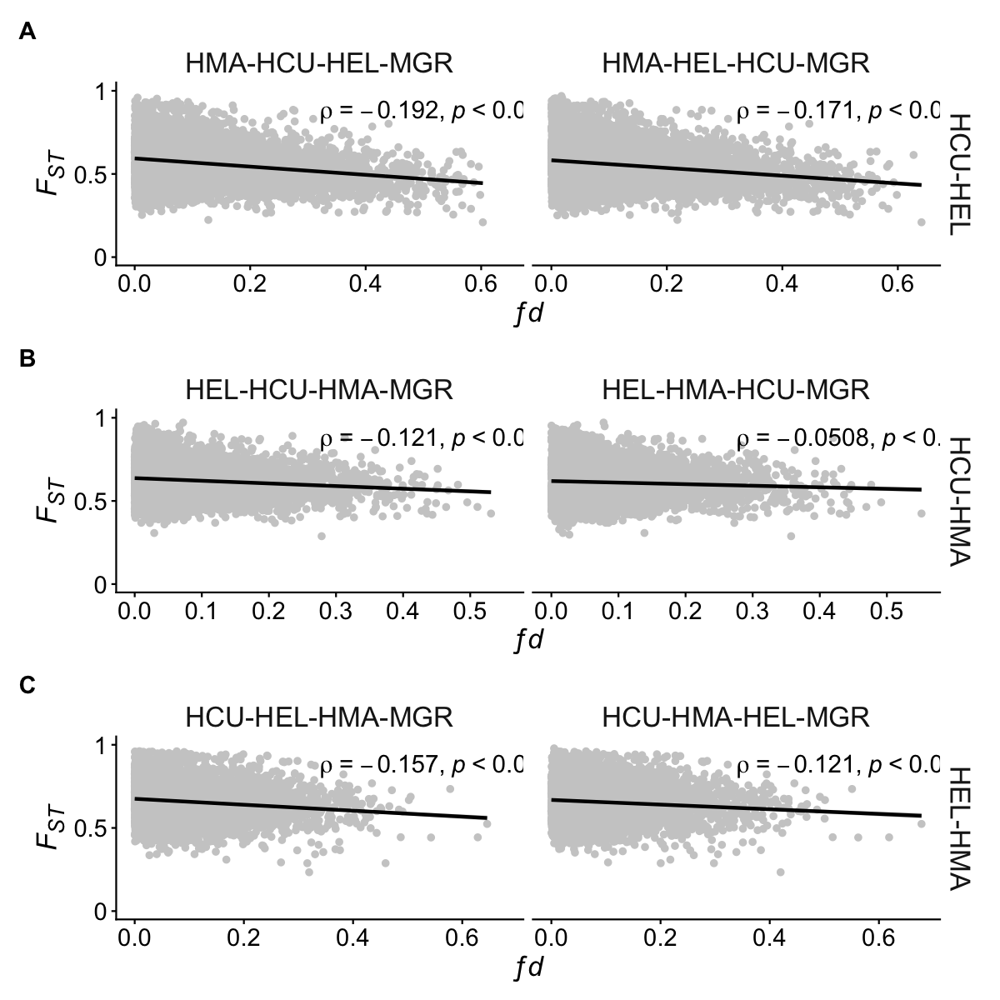
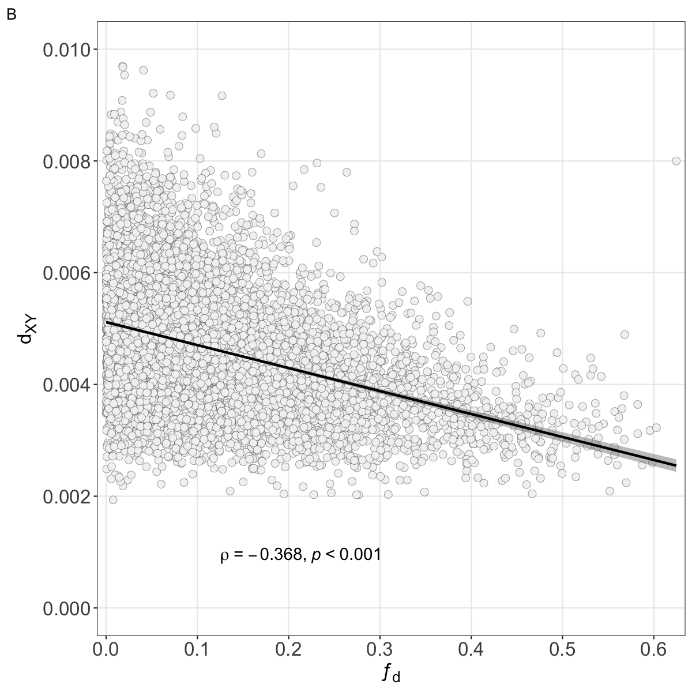
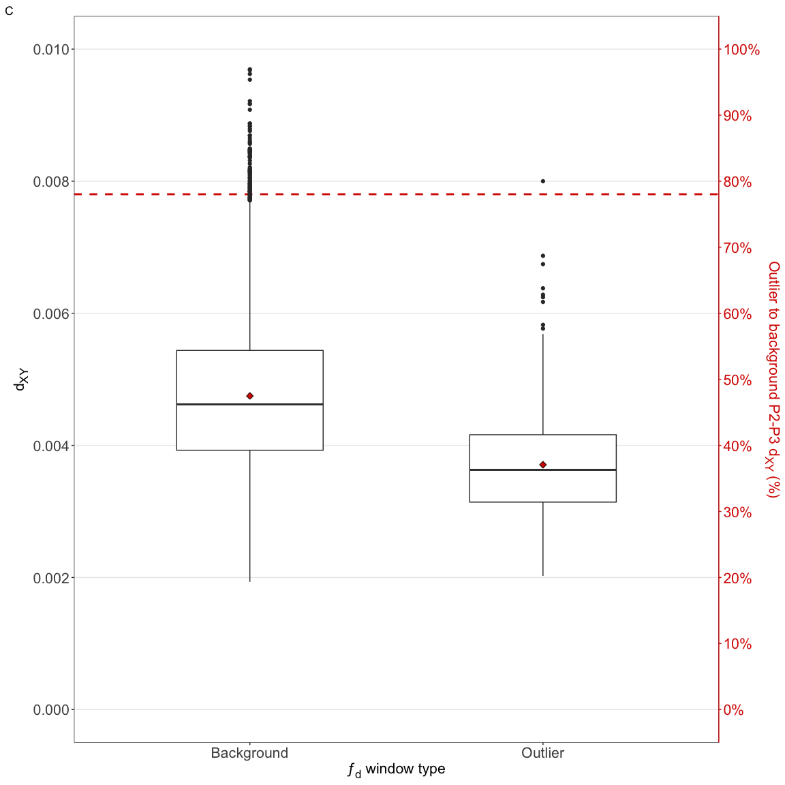
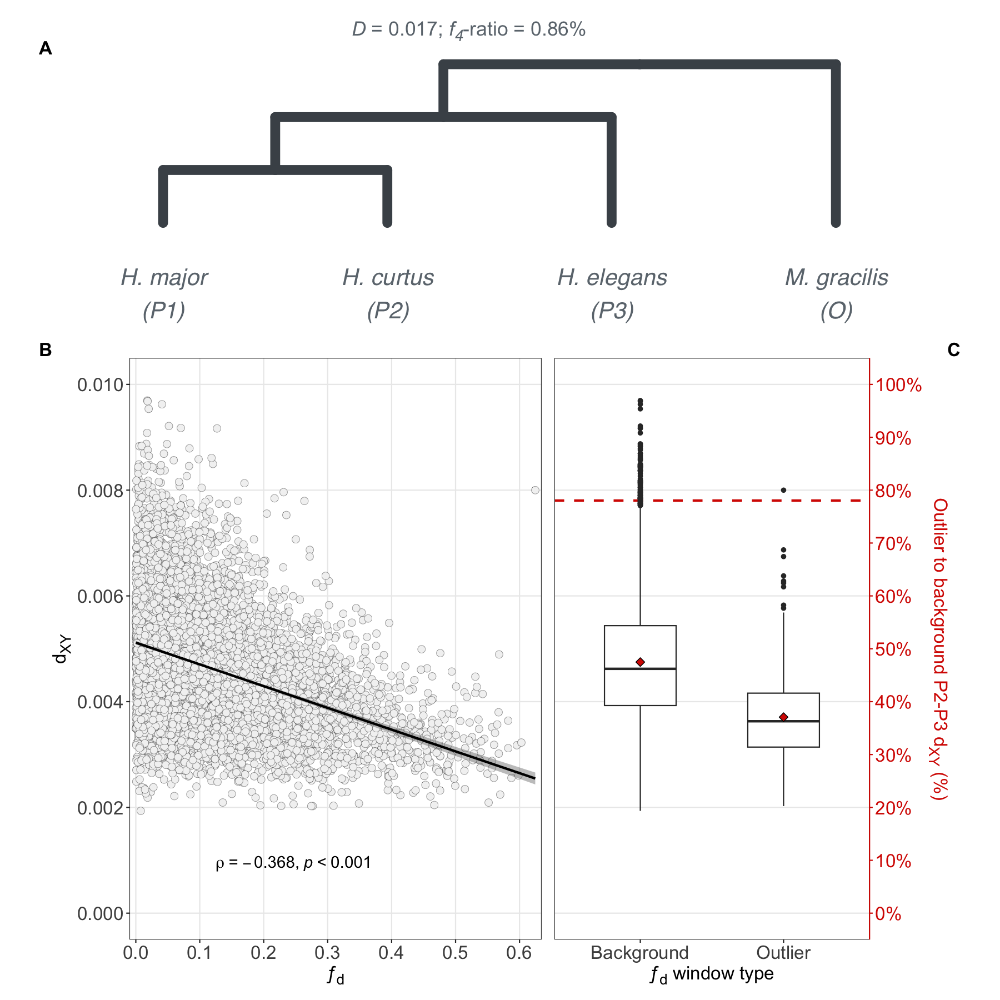
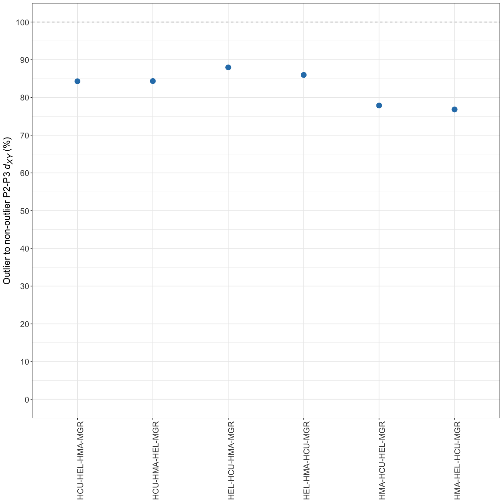
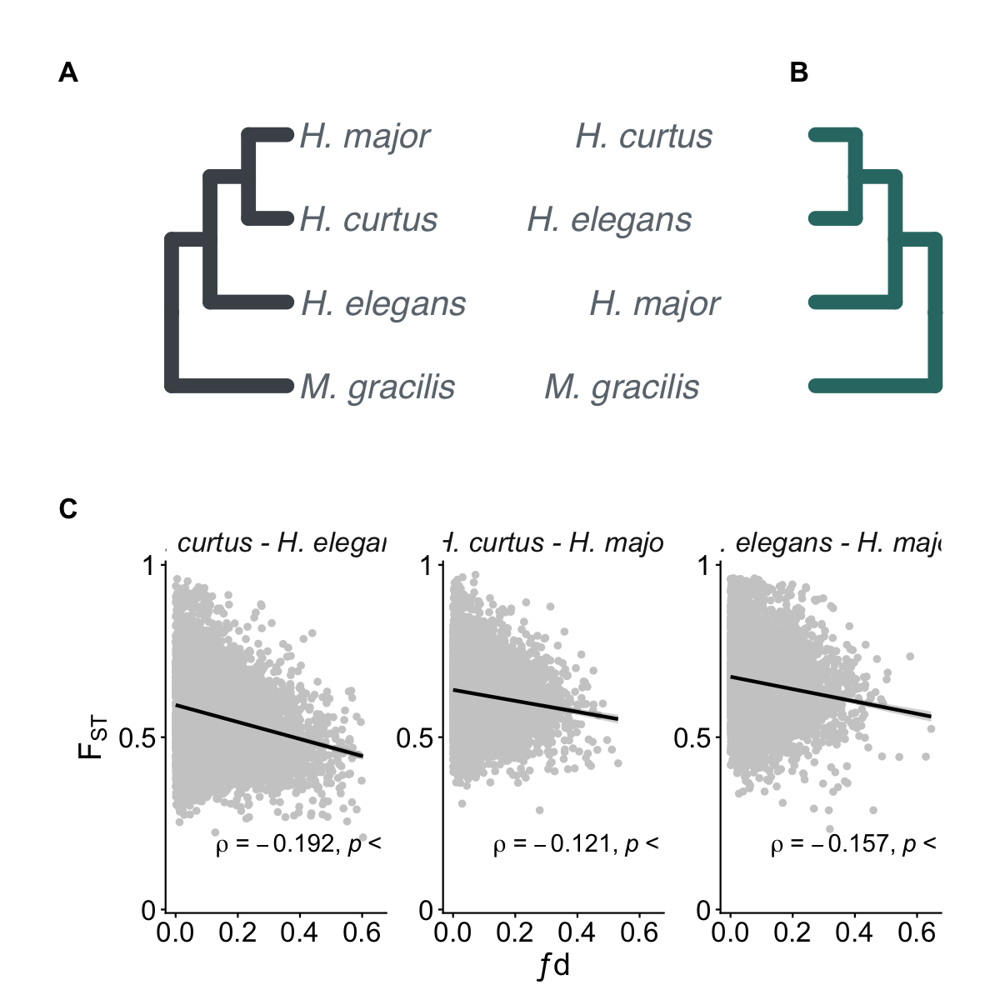

# Treeness and introgression
Alastair Ludington
2026-09-11

- [D-statitics tree](#d-statitics-tree)
- [Supplementary figure: All combinations of P2 and
  P3](#supplementary-figure-all-combinations-of-p2-and-p3)
- [Fst vs ƒ<sub>d</sub>](#fst-vs-ƒd)
- [d<sub>XY</sub> vs ƒ<sub>d</sub>](#dxy-vs-ƒd)
- [Comparing d<sub>XY</sub> in outlier ƒ<sub>d</sub> windows to
  non-outlier
  windows](#comparing-dxy-in-outlier-ƒd-windows-to-non-outlier-windows)
- [Figure 2](#figure-2)

D-statistics (ABBA-BABA) are used to test for introgression.
Specifically the test operates by assigning ancestral (`A`) and derived
(`B`) alleles, and checking if there is an excess of ABBA or BABA
patterns given a tree of `(((P1, P2), P3), O)` where `O` is the
outgroup. ABBA patterns indicate P2 and P3 have an excess of shared
alleles, while BABA patterns result when P1 and P3 have an excess. If
there were no introgression, we’d expect ABBA and BABA patterns to occur
equally frequently (reflecting ILS and the like).

ƒ<sub>d</sub> statistics are a variant of D-statistics, suitable for use
with windowed data. Here, we explore ƒ<sub>d</sub> results relative to
F<sub>ST</sub> and see what the relationship is. The expectation is that
introgression would result in high ƒ<sub>d</sub> within a window and low
F<sub>ST</sub>. We’ll also compare ƒ<sub>d</sub> to d<sub>XY</sub>, as
low d<sub>XY</sub> is known to artificially inflate the statistic (see
Simon Martin’s ƒ<sub>d</sub> 2015 MBE paper).

Data for this analysis were not only filtered on the 10% usable data
that we use in the diversity statistics, but also ensuring there are
adequate SNPs in the window (\$\$200) to accurately estimate the
statistics. We’ve also applied the chromosome 2 mask to this data to
minimise the impact of the misassembly in that region.

``` r
# ƒd
df_fd <- dir_ls(
    here("results", "04-treeness-introgression", "fd"),
    glob = "*clean*.csv"
) |>
    read_csv(col_types = cols(), id = "tree") |>
    mutate(tree = str_extract(basename(tree), "H.*MGR")) |>
    filter(
        # No excess of shared derived alleles - making no assumption that introgression
        # is not occurring, simply removing to prevent 0 becoming a hard-floor
        D > 0
    ) |>
    separate(col = tree, into = c("P1", "P2", "P3", "O"), remove = FALSE) |>
    mutate(
        scaffold = factor(str_remove(scaffold, "chr"), levels = 1:16),
        comparison = case_when(
            P2 == "HCU" & P3 == "HEL" ~ "HCU-HEL",
            P2 == "HCU" & P3 == "HMA" ~ "HCU-HMA",
            P2 == "HEL" & P3 == "HMA" ~ "HEL-HMA",
            
            P2 == "HEL" & P3 == "HCU" ~ "HCU-HEL",
            P2 == "HMA" & P3 == "HEL" ~ "HEL-HMA",
            P2 == "HMA" & P3 == "HCU" ~ "HCU-HMA",
            .default = "unknown"
        )
    )

df_fst_dxy <- read_csv(
    here("results", "03-diversity", "between", "clean-data.csv"),
    col_types = cols()
) |>
    mutate(chromosome = factor(chromosome, levels = 1:16))
```

## D-statitics tree

Here I’m creating the framework for the figure.

``` r
library(ggtree)
library(ggplot2)

tree_BBAA <- ape::read.tree(text = "(((A,B),C),D);")
tree_BBAA$tip.label <- c("H. elegans", "H. curtus", "H. major", "M. gracilis")
plot_BBAA <- ggtree(
    tree_BBAA, 
    size = 4,
    colour = "#317873"
) +
    geom_tiplab(
        angle = 0,
        hjust = 1.8,
        vjust = 0.5,
        offset = 0.2,
        size = 7,
        color = "#6c757d",
        fontface = "italic"
    ) +
    coord_cartesian(clip = "off") +
    scale_x_reverse() +
    theme_tree2(
        axis.line.x = element_blank(),
        axis.text.x = element_blank(),
        axis.ticks.x = element_blank(),
        plot.margin = unit(c(1,1,1,5), "cm")
    )

tree_Dmin <- ape::read.tree(text = "(((A,B),C),D);")
tree_Dmin$tip.label <- c("H. curtus", "H. major", "H. elegans", "M. gracilis")
plot_Dmin <- ggtree(
    tree_Dmin,
    size = 4,
    colour = "#495057"
) +
    geom_tiplab(
        angle = 0,
        hjust = -0.05,
        vjust = 0.5,
        offset = 0.1,
        size = 7,
        color = "#6c757d",
        fontface = "italic"
    ) +
    coord_cartesian(clip = "off") +
    # scale_x_reverse() +
    theme_tree2(
        axis.line.x = element_blank(),
        axis.text.x = element_blank(),
        axis.ticks.x = element_blank(),
        plot.margin = unit(c(1,5,1,1), "cm")
    )
```

## Supplementary figure: All combinations of P2 and P3

The program `Dsuite` produces a P1, P2, P3 and O combination that
maximises the `BBAA` pattern. This can be thought of as the “true” tree,
as it is the tree that supports P1 and P2 being sister taxa by having
the most shared derived alleles.

However, Hydrophis being a rapid radiation makes it difficult to know
the actual true topology. As such, we tested all combinations of of
snake species in P2 and P3 to ensure the signal of introgression is
reciprocal. The expectation is that regardless of topology -
(((P1,P2),P3),O) or (((P1,P3),P2),O) - the signal should be present.

``` r
df_data <- df_fd |>
    group_by(P2, P3) |>
    group_split() |>
    map(left_join, df_fst_dxy, by = join_by(comparison, scaffold == chromosome, start == window_pos_1)) |>
    bind_rows() |>
    filter(sitesUsed >= 200)

supp_plot_fd_fst_all_trees <- df_data |>
    group_by(comparison) |>
    group_split() |>
    map(\(x) {
        x |>
            ggplot(aes(x = fd, y = avg_wc_fst)) +
            geom_point(colour = "grey80") +
            ggh4x::facet_grid2(rows = vars(comparison), cols = vars(tree)) +
            geom_smooth(method = "lm", colour = "black") +
            ggpubr::stat_cor(
                method = "spearman",
                digits = 3,
                label.x.npc = "middle",
                label.y.npc = 0.9,
                p.accuracy = 0.001,
                show.legend = FALSE,
                cor.coef.name = "rho",
                size = 5
            ) +
            scale_x_continuous(
                breaks = scales::pretty_breaks(n = 5)
            ) +
            scale_y_continuous(
                limits = c(0, 1),
                breaks = c(0, 0.5, 1),
                labels = as.character(c(0, 0.5, 1))
            ) +
            labs(
                x = "*ƒd*",
                y = "*F<sub>ST</sub>*"
            ) +
            theme(
                strip.background = element_blank(),
                strip.text = element_text(size = 16),
                
                axis.text = element_text(size = 14),
                axis.title.x = element_markdown(size = 16),
                axis.title.y = element_markdown(size = 16)
            )
    })

supp_plot_fd_fst_all_trees <- wrap_plots(supp_plot_fd_fst_all_trees) +
    plot_annotation(tag_levels = "A") +
    plot_layout(nrow = 3) &
    theme(plot.tag = element_text(size = 14, face = "bold"))

ragg::agg_png(
    filename = here("manuscript", "figures", "supplementary", "supp-figure-X-fst_fd_all_topologies.png"),
    width = 1000,
    height = 1200,
    units = "px",
    scaling = 1.2
)
supp_plot_fd_fst_all_trees
invisible(dev.off())

supp_plot_fd_fst_all_trees
```



## Fst vs ƒ<sub>d</sub>

The underlying assumption with this test is that as F<sub>ST</sub>
increases, ƒ<sub>d</sub> is expected to decrease. Introgression is
expected to reduce genetic diversity.

``` r
plot_fd_fst <- df_data |>
    filter(P2 == "HCU" & P3 == "HEL" | P2 == "HCU" & P3 == "HMA" | P2 == "HEL" & P3 == "HMA") |>
    mutate(comparison = case_when(
        comparison == "HCU-HEL" ~ "H. curtus - H. elegans",
        comparison == "HCU-HMA" ~ "H. curtus - H. major",
        comparison == "HEL-HMA" ~ "H. elegans - H. major"
    )) |>
    ggplot(aes(x = fd, y = avg_wc_fst )) +
    geom_point(colour = "grey80") +
    ggh4x::facet_wrap2(vars(comparison), axes = "all") +
    geom_smooth(method = "lm", colour = "black") +
    ggpubr::stat_cor(
        method = "spearman",
        digits = 3,
        label.x.npc = 0.2,
        label.y.npc = 0.2,
        p.accuracy = 0.001,
        show.legend = FALSE,
        cor.coef.name = "rho",
        size = 5
    ) +
    scale_x_continuous(
        breaks = scales::pretty_breaks(n = 5)
    ) +
    scale_y_continuous(
        limits = c(0, 1),
        breaks = c(0, 0.5, 1),
        labels = as.character(c(0, 0.5, 1)),
        expand = c(0, 0.01)
    ) +
    labs(
        x = "ƒd",
        y = bquote(F[ST])
    ) +
    theme(
        strip.background = element_blank(),
        axis.text = element_text(size = 16),
        axis.title = element_text(size = 18),
        strip.text = element_text(size = 16, face = "italic")
    )

plot_fd_fst
```



## d<sub>XY</sub> vs ƒ<sub>d</sub>

As is reported in Martin et al. 2015, signals of high ƒ<sub>d</sub> can
be a product of low d<sub>XY</sub> rather than genuine introgression in
situations where there is ancestral population structure. As such,
certain evolutionary histories can result in regions of low
d<sub>XY</sub> being dense with ƒ<sub>d</sub> outlier loci even though
evolutionarily there has been no allele sharing between focal
populations.

While we do not have simulation data to establish what a null signal
might look like in these snake species, we can at least check what’s
going on. We see weak-to-moderate significant negative correlations.
Both F<sub>ST</sub> and d<sub>XY</sub> reporting significant negative
correlations may indicate that allele sharing is ocurring between these
species.

``` r
plot_fd_dxy <- df_data |>
    filter(P2 == "HCU" & P3 == "HEL" | P2 == "HCU" & P3 == "HMA" | P2 == "HEL" & P3 == "HMA") |>
    mutate(comparison = case_when(
        comparison == "HCU-HEL" ~ "H. curtus - H. elegans",
        comparison == "HCU-HMA" ~ "H. curtus - H. major",
        comparison == "HEL-HMA" ~ "H. elegans - H. major"
    )) |>
    ggplot(aes(x = fd, y = avg_dxy)) +
    geom_point(colour = "grey80") +
    ggh4x::facet_wrap2(vars(comparison)) +
    geom_smooth(method = "lm", colour = "black") +
    ggpubr::stat_cor(
        method = "spearman",
        digits = 3,
        label.x.npc = 0.2,
        label.y.npc = 0.8, 
        p.accuracy = 0.001,
        show.legend = FALSE,
        cor.coef.name = "rho",
        size = 5
    ) +
    scale_x_continuous(
        breaks = scales::pretty_breaks(n = 5)
    ) +
    scale_y_continuous(
        breaks = scales::pretty_breaks(n = 5)
    ) +
    labs(
        x = "*ƒd*",
        y = "*d<sub>XY</sub>*",
    ) +
    theme(
        strip.background = element_blank(),
        axis.text = element_text(size = 14),
        axis.title.x = element_markdown(size = 16),
        axis.title.y = element_markdown(size = 16),
        strip.text = element_text(size = 16, face = "italic")
    )

ragg::agg_png(
    filename = here("manuscript", "figures", "supplementary", "supp-figure-X-fd_dxy-correlation.png"),
    width = 1000,
    height = 800,
    units = "px"
)
plot_fd_dxy
invisible(dev.off())

plot_fd_dxy
```



## Comparing d<sub>XY</sub> in outlier ƒ<sub>d</sub> windows to non-outlier windows

Expect that outlier windows have significantly lower ƒ<sub>d</sub>,
though we don’t know the true ancestral history. Ancestral structure
might be driving the low d<sub>XY</sub> signal resulting in the elevated
ƒ<sub>d</sub> for a window. Below we explore d<sub>XY</sub> in outlier
windows, examining if the mean statistical difference between outliers
and non-outliers is significant. This is a figure similar to Figure 4
from [Martin et al. (2015)](doi:10.1093/molbev/msu269).

We see that means are significantly different between outlier and
non-outlier windows. The real question remains - is this driven by
introgression or ancestral structure/chance genomic similarity?

``` r
df_data |> 
    mutate(
        fd_cutoff = quantile(fd, probs = 0.9, na.rm = TRUE),
        fd_outlier = fd >= fd_cutoff,
        .by = tree
    ) |>
    summarise(
        p_value = wilcox.test(avg_dxy ~ fd_outlier)$p.value,
        .by = tree
    ) |>
    mutate(p_adj = p.adjust(p_value, method = "BH"))
```

    # A tibble: 6 × 3
      tree              p_value     p_adj
      <chr>               <dbl>     <dbl>
    1 HMA-HCU-HEL-MGR 1.31e-150 3.94e-150
    2 HEL-HCU-HMA-MGR 1.24e- 44 1.24e- 44
    3 HMA-HEL-HCU-MGR 1.80e-188 1.08e-187
    4 HCU-HEL-HMA-MGR 2.86e- 94 5.72e- 94
    5 HEL-HMA-HCU-MGR 4.34e- 59 5.20e- 59
    6 HCU-HMA-HEL-MGR 1.01e- 83 1.51e- 83

``` r
# Dxy in fd outlier vs non-outlier windows
df_data |> 
    mutate(
        fd_cutoff = quantile(fd, probs = 0.9, na.rm = TRUE),
        fd_outlier = fd >= fd_cutoff,
        .by = tree
    ) |>
    summarise(
        n_windows = n(),
        mean_dxy = mean(avg_dxy, na.rm = TRUE),
        sd_dxy = sd(avg_dxy, na.rm = TRUE),
        median_dxy = median(avg_dxy, na.rm = TRUE),
        .by = c(tree, fd_outlier)
    ) |>
    ggplot(
        aes(
            x = tree, 
            y = mean_dxy, 
            colour = fd_outlier, 
            group = fd_outlier)
    ) +
    geom_point(
        size = 3,
        position = position_dodge(width = 0.9)
    ) +
    geom_errorbar(
        aes(ymin = mean_dxy - sd_dxy, ymax = mean_dxy + sd_dxy), 
        position = position_dodge(width = 0.9),
        linewidth = 1,
        width = 0
    ) +
    scale_colour_manual(values = c("red", "black")) +
    labs(
        y = "Mean *d~XY~*",
    ) +
    theme_bw() +
    theme(
        axis.title.y = element_markdown(size = 16),
        axis.text.x = element_text(angle = 90, size = 14),
        axis.title.x = element_blank()
    )
```



Figure similar to figure 5 from [Martin et
al. (2015)](doi:10.1093/molbev/msu269). For “outlier windows”, defined
by fd quartile, compare d<sub>XY</sub> (P2-P3) in the outlier windows to
d<sub>XY</sub> in the non-outlier windows.

Expectation is that gene-flow will cause some windows to coalesce more
quickly, which results in the outlier windows returning a *smaller*
percentage in the figure - i.e. outlier d<sub>XY</sub> as a percentage
of background d<sub>XY</sub> is small when outlier d<sub>XY</sub> is
considerably less than the genomic average d<sub>XY</sub>.

We see values hovering around the 75-90% range, indicating that most of
the “introgression” signal is likely ancestral structure or simply
regions of low divergence rather than true gene flow. We haven’t got
replicates so we can’t look at spread like Martin et al. (2015) with
their simulations, but we can get an idea of what we’re dealing with.

My take, based on the ABBA-BABA stats is that there has likely been
historical introgression, but not ongoing introgression between these
snakes. They’re a rapid radiation, so not unexpected that they’ll have
shared ancestry.

``` r
df_data |> 
    mutate(
        fd_cutoff = quantile(fd, probs = 0.9, na.rm = TRUE),
        fd_outlier = fd >= fd_cutoff,
        .by = tree
    )  |>
    summarise(
        P2P3_dxy_outlier = mean(avg_dxy[fd_outlier], na.rm = TRUE),
        P2P3_dxy_nonoutlier = mean(avg_dxy[!fd_outlier], na.rm = TRUE),
        P2P3_dxy_effect = 100 * (P2P3_dxy_outlier / P2P3_dxy_nonoutlier),
        n_outlier = sum(fd_outlier, na.rm = TRUE),
        n_nonoutlier = sum(!fd_outlier, na.rm = TRUE),
        .by = tree
    ) |>
    ggplot(aes(x = tree, y = P2P3_dxy_effect)) +
    geom_hline(yintercept = 100, linetype = 2, colour = "grey50") +
    geom_point(size = 4, colour = "#2c7fb8") +
    scale_y_continuous(
        limits = c(0,100),
        breaks = scales::breaks_pretty(n = 10),
        # labels = as.character(seq.int(0, 100, 10))
    ) +
    labs(
        y = "Outlier to non-outlier P2-P3 *d~XY~* (%)"
        # y = expression(paste("Outlier to Non-Outlier P2-P3 ", italic(d[XY]), " (%)"))
    ) +
    theme_bw() +
    theme(
        axis.title.y = element_markdown(size = 16),
        axis.text = element_text(size = 14),
        axis.text.x = element_text(angle = 90),
        axis.title.x = element_blank()
    )
```



## Figure 2

Below I create the final figure, which is cleaned up slightly in
inkscape.

``` r
fig_2 <- ((plot_Dmin + plot_BBAA) / (plot_fd_fst)) +
    plot_annotation(tag_levels = "A") &
    theme(
        plot.tag = element_text(face = "bold", size = 16)
    )

pdf(
    file = here("manuscript", "figures", "figure-2-introgression.pdf"),
    width = 4000/300, height = 4000/300
)
fig_2
invisible(dev.off())

fig_2
```


