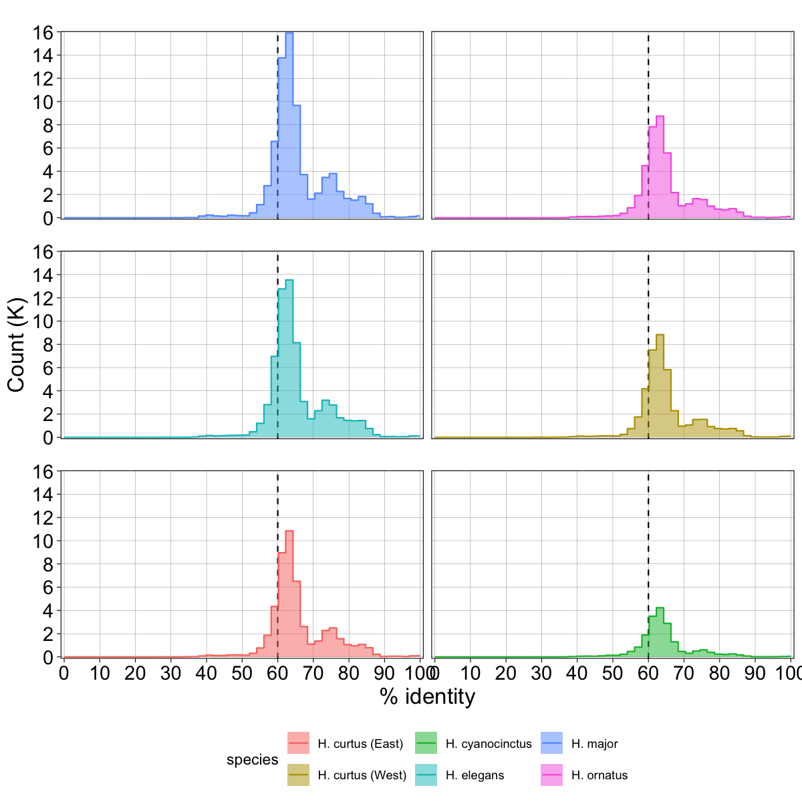
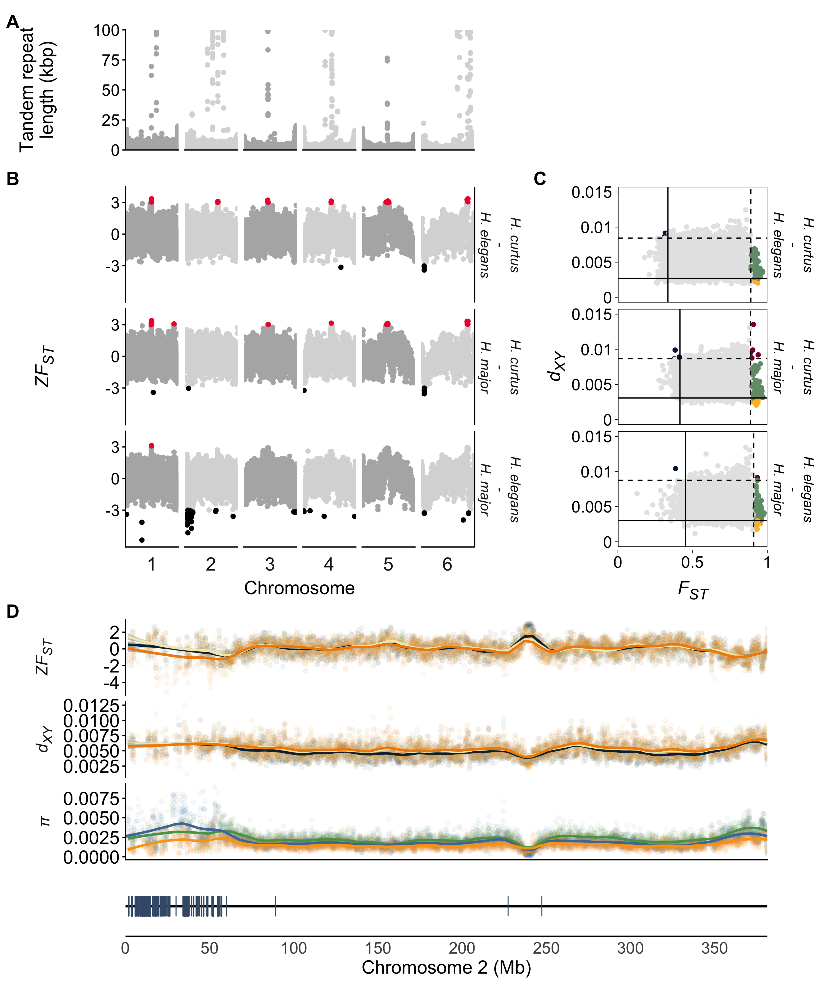

# Vomeronasal genes: Chromosome 2
Alastair Ludington
2026-09-11

- [V2R annotation pipeline (in
  brief)](#v2r-annotation-pipeline-in-brief)
  - [Step 1: Protein alignment](#step-1-protein-alignment)
  - [Step 2: 7tm annotation](#step-2-7tm-annotation)
- [V2R gene content](#v2r-gene-content)
  - [7tm’s in problematic regions](#7tms-in-problematic-regions)
  - [Divergence signal *H. major*](#divergence-signal-h-major)
  - [Supplementary: V2Rs (7TM) in other
    snakes](#supplementary-v2rs-7tm-in-other-snakes)

The start of chromosome 2 shows low divergence in the *H. elegans* - *H.
major* comparison, even after masking putatively misassembled regions.
This region is known to house many V2R genes (Li et al. 2021).

Here we overlay the divergence signals with V2R annotations on the *H.
major* genome. We then show the number of V2R genes in other snakes as a
general comparison.

## V2R annotation pipeline (in brief)

The scripts for obtaining potential V2R genes are in the
[scripts](https://github.com/a-lud/hydrophis-popgen/tree/main/scripts)
directory. Annotating V2Rs is tricky, as they often exist in large
clusters meaning gene prediction tools have trouble. Instead, we use the
approach from Li et al. (2021) where we use the presence of
7-transmembrane domains (7tm) as evidence of a V2R gene.

The pipeline we developed is broken into two phases; Protein alignment
to obtain gene regions and 7tm annotation and curation.

### Step 1: Protein alignment

V2R protein sequences were downloaded from NCBI NR, Swiss-Prot and
TrEMBL databases.

Headers were simplified - e.g. from `>tr|A0A1S3WWH9|A0A1S3WWH9_ERIEU` to
`V2R:A0A1S3WWH9` - and merged from each source into a single file.
Representative sequences were obtained using `mmseqs easy-cluster`.
Parameters from the `mmseqs2`
[user-guide](https://mmseqs.com/latest/userguide.pdf) were followed to
ensure short fragments weren’t used as representative sequences.

To help parameterise `miniprot` alignment, we obtained V2R intron sizes
by extracting V2R sequences from *P. textilis*, *N. scutatus*, *P.
mucrosquamatus*, *C. adamanteus* and *T. elegans*, which all have RefSeq
gene annotations.

``` r
intron_dists <- dir_ls(
    here("results", "05-v2r", "intron-length-dist"),
    glob = "*introns.gff3"
) |>
    read_tsv(
        comment = "#",
        col_names = FALSE,
        id = "species",
        col_types = cols()
    ) |>
    filter(X3 == "intron") |>
    select(species, start = X4, end = X5, gene = X9) |>
    mutate(
        species = sub(".+/intron-length-dist/(.*)-v2r.+", "\\1", species),
        gene = case_when(
            species == "crotalus_adamanteus" ~ sub(
                ".+locus_tag=(.*);orig_protein_id.+",
                "\\1",
                gene
            ),
            species == "thamnophis_elegans" ~ sub(
                ".+gene=(.*);product.+",
                "\\1",
                gene
            ),
            .default = sub(".+gene=(.*);product.*", "\\1", gene)
        ),
        length = abs(end - start),
        mean_species = mean(length),
        median_species = median(length),
        .by = species
    ) |>
    mutate(
        mean_species_gene = mean(length),
        median_species_gene = median(length),
        .by = c(species, gene)
    )

intron_dists |>
    ggplot(aes(x = length, fill = species, colour = species)) +
    geom_step(
        stat = "bin",
        bins = 50,
        direction = "mid"
    ) +
    geom_histogram(
        bins = 50,
        position = "identity",
        alpha = 0.3,
        colour = NA
    ) +
    scale_y_continuous(breaks = scales::pretty_breaks(n = 10), expand = c(0.01, 0)) +
    scale_colour_manual(values = paletteer::paletteer_d("PNWColors::Bay")) +
    scale_fill_manual(values = paletteer::paletteer_d("PNWColors::Bay")) +
    annotation_logticks(sides = 'b', outside = TRUE) +
    coord_cartesian(clip = "off") +
    scale_x_log10(labels = scales::label_number()) +
    labs(x = "\nLength (bp)") +
    guides(fill = guide_legend(ncol = 2), colour = guide_legend(ncol = 2)) +
    theme_linedraw() +
    theme(
        axis.text = element_text(size = 14),
        axis.text.x = element_text(vjust = -2),
        axis.title = element_text(size = 16),
        panel.grid.minor = element_blank(),
        legend.position = "bottom"
    )
```


Intron-size peaks around 1-2kbp in length. If we look at the 20 longest
introns, we can see that there are some massive ones (\>100kbp), but
there is a jump from 30-40Kbp mark to the higher values. Consequently,
we used a value of 45,000bp as our max-intron size when aligning the
proteins.

``` r
intron_dists |> 
    arrange(desc(length)) |> 
    print(n = 20)
```

    # A tibble: 7,323 × 9
       species                 start    end gene  length mean_species median_species
       <chr>                   <dbl>  <dbl> <chr>  <dbl>        <dbl>          <dbl>
     1 pseudonaja_textilis    3.01e4 1.92e5 LOC1… 161952        2815.          1376.
     2 protobothrops_mucrosq… 7.13e3 1.46e5 LOC1… 139029        2279.          1250.
     3 protobothrops_mucrosq… 5.52e4 1.77e5 LOC1… 121419        2279.          1250.
     4 thamnophis_elegans     3.40e5 4.38e5 LOC1…  98727        2434.          1357 
     5 thamnophis_elegans     1.23e8 1.23e8 LOC1…  71143        2434.          1357 
     6 thamnophis_elegans     1.23e8 1.23e8 LOC1…  49849        2434.          1357 
     7 pseudonaja_textilis    3.30e4 7.32e4 LOC1…  40143        2815.          1376.
     8 thamnophis_elegans     2.18e5 2.57e5 LOC1…  39819        2434.          1357 
     9 pseudonaja_textilis    7.86e3 4.54e4 LOC1…  37519        2815.          1376.
    10 protobothrops_mucrosq… 1.83e4 5.53e4 LOC1…  36964        2279.          1250.
    11 pseudonaja_textilis    5.37e4 8.87e4 LOC1…  35014        2815.          1376.
    12 notechis_scutatus      4.16e6 4.19e6 LOC1…  33298        2748.          1680 
    13 notechis_scutatus      1.65e5 1.97e5 LOC1…  31987        2748.          1680 
    14 thamnophis_elegans     1.64e8 1.64e8 LOC1…  28252        2434.          1357 
    15 crotalus_adamanteus    3.61e6 3.64e6 NXF2…  28175        1968.          1233 
    16 protobothrops_mucrosq… 8.43e4 1.12e5 LOC1…  27704        2279.          1250.
    17 pseudonaja_textilis    9.76e4 1.24e5 LOC1…  25886        2815.          1376.
    18 pseudonaja_textilis    7.92e3 3.37e4 LOC1…  25825        2815.          1376.
    19 pseudonaja_textilis    2.14e5 2.39e5 LOC1…  25144        2815.          1376.
    20 pseudonaja_textilis    7.85e4 1.03e5 LOC1…  24546        2815.          1376.
    # ℹ 7,303 more rows
    # ℹ 2 more variables: mean_species_gene <dbl>, median_species_gene <dbl>

Protein alignments were manually curated to split chimeric alignments.
Curated alignments were then formatted with `AGAT` before “gene” loci
were merged if they overlapped using `bedtools merge`, resulting in
**putative V2R** **gene loci**.

The issue is these numbers are much lower than expected, likely due to:

- sequence complexity at the start of chromosome 2
- mapping divergent protein sequences

As such, we used these proteins as a first pass, and used the features
(7tm) in these alignments for additional curation.

### Step 2: 7tm annotation

V2R sequences were extracted from the *H. major* reference genome using
the V2R `miniprot` alignments above. These sequences were then searched
against `Pfam` to annotate functional domains using `hmmerscan`. The
`.domtblout` file was then filtered using the following criteria:

- c-evalue $\leq1e^{-5}$
- The length of the alignment must match the length of the Pfam target

The sequences were extracted using `bedtools getfasta`, before being
clustered into representative sequences using `CD-HIT`.

With the curated candidate sequences, we then searched the genomes of
the other sea snakes six snakes using `TBLASTN`.

`TBLASTN` hits were then filtered using the code below.

``` r
cnames <- c(
    "qseqid",
    "sseqid",
    "pident",
    "length",
    "mismatch",
    "gapopen",
    "qstart",
    "qend",
    "sstart",
    "send",
    "evalue",
    "bitscore"
)

# Chromosome renaming
rename_hcy <- read_tsv(
    here("data", "HCY-seq-report.tsv"),
    col_types = cols()
) |>
    select(sseqid = `GenBank seq accession`, chrom = `Chromosome name`) |>
    filter(str_starts(sseqid, "CM")) |>
    mutate(chrom = paste0("chr", chrom))

rename_hcu_ncbi <- read_tsv(
    here("data", "HCU-NCBI-seq-report.tsv"),
    col_types = cols()
) |>
    select(sseqid = `GenBank seq accession`, chrom = `Chromosome name`) |>
    filter(str_starts(sseqid, "CM")) |>
    mutate(chrom = paste0("chr", chrom))

# Ordering
chrs <- c(paste0("chr", 1:18), "chrZ")
forder <- c("HMA", "HOR", "HEL", "HCU-UAE", "HCU-NCBI", "HCY")

# Filters: alignment length == query length, alignment >= 200aa, e-value <= 1e-10
df_tblastn <- fs::dir_ls(
    here("results", "05-v2r", "tblastn-7tm"),
    glob = "*outfmt6"
) |>
    read_tsv(
        col_names = cnames,
        col_types = cols(),
        id = "file"
    ) |>
    mutate(file = str_remove(basename(file), ".7tm.*")) |>
    left_join(bind_rows(rename_hcy, rename_hcu_ncbi)) |>
    mutate(
        sseqid = ifelse(is.na(chrom), sseqid, chrom),
        sseqid = factor(sseqid, levels = chrs),
        species = case_when(
            file == "HCU-NCBI" ~ "H. curtus (East)",
            file == "HCU-UAE" ~ "H. curtus (West)",
            file == "HCY" ~ "H. cyanocinctus",
            file == "HEL" ~ "H. elegans",
            file == "HMA" ~ "H. major",
            file == "HOR" ~ "H. ornatus"
        ),
        file = factor(file, forder)
    ) |>
    select(-chrom)
```

    Joining with `by = join_by(sseqid)`

``` r
# Length distribution before filtering
df_tblastn |>
    ggplot(aes(x = length, fill = species)) +
    geom_step(
        aes(colour = species),
        stat = "bin",
        bins = 50,
        direction = "mid"
    ) +
    geom_histogram(bins = 50, alpha = 0.5, position = "identity") +
    scale_y_continuous(
        name = "Count (K)",
        breaks = scales::pretty_breaks(n = 6), 
        labels = scales::label_number(scale = 1e-3),
        expand = c(0.01, 0)
    ) +
    scale_x_continuous(breaks = scales::pretty_breaks(n = 5), expand = c(0.01, 0)) +
    facet_wrap(vars(file), ncol = 2) +
    labs(x = "Length (bp)") +
    guides(fill = guide_legend(ncol = 2)) +
    theme_linedraw() +
    theme(
        strip.background = element_blank(),
        axis.text = element_text(size = 14),
        axis.title = element_text(size = 16),
        panel.grid.minor = element_blank(),
        legend.position = "bottom"
    )
```


We can see that most alignments are $\geq$ 200aa in length, so we filter
anything out less than this. This also fits with most 7tm domains that
were predicted having lengths ~250aa, which is where we see the biggest
peak in all datasets.

Next, we visualise the percentage-identity (pid) distribution. At this
point, there are a lot of redundant features still in the table
(i.e. different query sequences aligning to the same locus). Here, we’re
just trying to see what a reasonable pid-threshold would be.

Evidently, it’s around 60%, as there is a peak there, and almost all the
data resides to the right of this mark.

``` r
df_tblastn <- df_tblastn |>
    filter(qstart == 1, qend == length, length >= 200, evalue <= 1e-10) |>
    arrange(file, sseqid, sstart, desc(bitscore))

# NOTE: there are many redundant hits to putative loci in this figure. The goal
# is to get an idea of what the pid distribution looks like to inform filtering.
# The peak at 60 and 70(-ish) will have counts higher than the final collapsed
# version
df_tblastn |>
    ggplot(aes(x = pident, fill = species)) +
    geom_vline(xintercept = 60, linetype = "dashed") +
    geom_step(
        aes(colour = species),
        stat = "bin",
        bins = 50,
        direction = "mid"
    ) +
    geom_histogram(bins = 50, alpha = 0.5, position = "identity") +
    scale_y_continuous(
        name = "Count (K)",
        breaks = scales::pretty_breaks(n = 6), 
        labels = scales::label_number(scale = 1e-3),
        expand = c(0.01, 0)
    ) +
    scale_x_continuous(
        name = "% identity", 
        limits = c(0, 100),
        breaks = scales::pretty_breaks(n = 10), 
        expand = c(0.01, 0)
    ) +
    facet_wrap(vars(file), ncol = 2) +
    guides(fill = guide_legend(ncol = 2)) +
    theme_linedraw() +
    theme(
        axis.text = element_text(size = 14),
        axis.title = element_text(size = 16),
        strip.background = element_blank(),
        panel.grid.minor = element_blank(),
        strip.background.x = element_blank(),
        legend.position = "bottom"
    )
```

    Warning: Removed 12 rows containing missing values or values outside the scale range
    (`geom_bar()`).



With that in mind, we apply the %-ID filter and export the valid
co-ordinates. There are going to be many redundant hits which will be
filtered out in the next step.

``` r
# Writing the curated TBLASTN hits to BED files
df_tblastn |>
    filter(pident >= 60) |>
    mutate(
        start = ifelse(sstart > send, send, sstart),
        end = ifelse(sstart > send, sstart, send)
    ) |>
    select(file, sseqid, start, end) |>
    arrange(file, sseqid, start) |>
    (\(x) split(x, x$file))() |>
    iwalk(\(x, i) {
        # If sample is Hcy/Hcu - fix chromosome names back to NCBI version
        if (i == "HCY") {
            x <- x |>
                left_join(rename_hcy, by = join_by(sseqid == chrom)) |>
                select(file, sseqid = sseqid.y, start, end)
        } else if (i == "HCU-NCBI") {
            x <- x |>
                left_join(rename_hcu_ncbi, by = join_by(sseqid == chrom)) |>
                select(file, sseqid = sseqid.y, start, end)
        }
        x |>
            select(-file) |>
            write_tsv(
                file = glue::glue(
                    here(
                        "results",
                        "05-v2r",
                        "tblastn-7tm",
                        "{i}-7tm.candidates.bed"
                    )
                ),
                col_names = FALSE
            )
    })
```

The command `bedtools merge` was then used to collapse overlapping 7tm
domains, reducing the redundancy massively, and giving us our final V2R
proxy set.

## V2R gene content

Now we’re interested in actually exploring V2R content in snakes. We’ll
overlay the divergence estimates for the three sea snakes along the *H.
major* genome, along with the *H. major* V2R annotations.

Then we’ll explore V2R content in a range of other snakes. Note that we
aren’t performing manual curation of chromosome 2 where the V2Rs exist
in the other snakes, so there is very likely going to be some
misassembly. The numbers should be considered as a snapshot of V2R
content as the genomes exist today.

``` r
# Colour palettes
pal_between <- c(
    "HCU-HEL" = "#09283CFF",
    "HCU-HMA" = "#F2EBBBFF",
    "HEL-HMA" = "#F18B00FF"
)

pal_within <- c("HMA" = "#fca311", "HCU" = "#59A14FFF", "HEL" = "#4E79A7FF")

pal_long <- c(
    "HCU-HEL" = "#09283CFF",
    "HCU-HMA" = "#F2EBBBFF",
    "HEL-HMA" = "#F18B00FF",
    "HMA" = "#fca311", 
    "HCU" = "#59A14FFF", 
    "HEL" = "#4E79A7FF"
)

# Partial figure 4
fig_4_partial <- read_rds(here("manuscript", "figures", "figure-4-partial.rds"))

# Mask regions
gr_mask <- read_csv(
    here("results", "05-v2r", "hifi-coverage", "mask-regions.csv"),
    col_types = cols()
) |>
    select(chrom, start = xmin, end = xmax) |>
    GenomicRanges::makeGRangesFromDataFrame()

# Already filtered for mis-assembly
df_fst_dxy <- read_csv(
    here("results", "03-diversity", "between", "clean-data.csv"),
    col_types = cols()
) |>
    mutate(chromosome = factor(chromosome, levels = 1:16))

df_pi <- read_csv(
    here(
        "results",
        "03-diversity",
        "within",
        "ref-hmaj",
        "clean-data.csv"
    ),
    col_types = cols()
) |>
    mutate(chromosome = factor(chromosome, levels = 1:16))

df_7tm <- read_tsv(
    here(
        "results",
        "05-v2r",
        "tblastn-7tm",
        "HMA-7tm.candidates.merged.bed"
    ),
    col_names = c("chrom", "start", "end"),
    col_types = cols()
)
```

### 7tm’s in problematic regions

First thing we do is identify which 7tm (V2Rs) overlap problematic
regions. A total of 123 7tm sequences overlap the mask-regions. These
genes may belong to the Z chromosome, or simply exist in hard to
assemble chomosome 2 sequence.

As such, I’ve elected to not add them to either chromosome, instead
leaving them as their own category.

``` r
overlaps <- GenomicRanges::findOverlaps(
    df_7tm |> GenomicRanges::makeGRangesFromDataFrame(keep.extra.columns = TRUE),
    gr_mask
)

df_7tm$overlaps_mask <- FALSE
df_7tm$overlaps_mask[S4Vectors::queryHits(overlaps)] <- TRUE

df_7tm <- df_7tm |>
    mutate(
        chrom = ifelse(overlaps_mask, "mask region", chrom),
        type = "CDS", 
        strand = "+"
    )

df_7tm |>
    summarise("7tm_count" = n(), .by = chrom)
```

    # A tibble: 12 × 2
       chrom       `7tm_count`
       <chr>             <int>
     1 chr1                 68
     2 mask region         123
     3 chr2                433
     4 chr3                  1
     5 chr4                 10
     6 chr6                  3
     7 chr7                  1
     8 chr8                  9
     9 chr10                 2
    10 chr12                32
    11 chr15                55
    12 chrZ                172

### Divergence signal *H. major*

Now that we’ve masked genes that exist in the problematic regions of
chromosome 2, we can go an build the figure for the manuscript.

``` r
# Gene track
suppressPackageStartupMessages({library(gggenomes)})
```

    Warning: package 'gggenomes' was built under R version 4.5.2

``` r
fai <- read_tsv(
    here("data", "genomes", "HMA.fa.fai"), 
    c("chrom", "length"), 
    col_types = cols(), 
    col_select = c(chrom, length)
) |>
    filter(chrom == "chr2") |>
    mutate(seq_id = "H. major")

tmp <- df_7tm |> 
    filter(chrom == "chr2", !overlaps_mask) |>
    mutate(seq_id = "H. major", feature = "7TM domain") 

p_track <- gggenomes(
    seqs = fai,
    genes = tmp
) +
    geom_seq(linewidth = 1) +
    geom_gene(
        aes(fill = feature, colour = feature),
        rna_aes=aes(fill = fill, colour=colour),
        size = 6,
    ) +
    scale_colour_manual(values = c("#415a77", "#fcbf49")) +
    scale_fill_manual(values = c("#415a77", "#fcbf49")) +
    scale_x_continuous(
        name = "Chromosome 2 (Mb)",
        labels = scales::label_number(scale = 1e-6),
        breaks = scales::breaks_pretty(n = 10),
        expand = c(0,0)
    ) +
    theme_minimal() +
    theme(
        axis.line.x = element_line(size = 0.5),
        legend.position = "none",
        panel.grid = element_blank(),
        axis.text.y = element_blank(),
        axis.title.y = element_blank(),
        axis.ticks.y = element_blank(),,
        axis.title.x = element_text(size = 16),
        axis.text.x = element_text(size = 14),
        plot.margin = grid::unit(c(0, 0, 5, 0), "mm")
    )
```

    Warning: The `size` argument of `element_line()` is deprecated as of ggplot2 3.4.0.
    ℹ Please use the `linewidth` argument instead.

``` r
# Divergence track
between_long <- df_fst_dxy |>
    pivot_longer(names_to = "statistic", values_to = "values", c(zfst, avg_dxy)) |>
    select(comparison, chromosome, window_pos_1, window_pos_2, statistic, values)

within_long <- df_pi |>
    pivot_longer(names_to = "statistic", values_to = "values", avg_pi) |>
    rename(comparison = pop) |>
    select(comparison, chromosome, window_pos_1, window_pos_2, statistic, values)

data_long <- bind_rows(between_long, within_long) |>
    mutate(
        statistic = replace_when(
            statistic,
            statistic == "zfst" ~ "*ZF~ST~*",
            statistic == "avg_dxy" ~ "*d~XY~*",
            statistic == "avg_pi" ~ "*π*"
        ),
        statistic = forcats::fct_inorder(statistic)
    )

p_div <- data_long |>
    filter(chromosome == 2) |>
    ggplot(
        aes(
            x = floor((window_pos_1 + window_pos_2)/ 2), 
            y = values, 
            colour = comparison
        )
    ) +
    geom_point(alpha = 0.05) +
    geom_smooth(method = "loess", span = 0.1, alpha = 0.5) +
    scale_x_continuous(
        name = "Position (Mb)",
        labels = scales::label_number(scale = 1e-6),
        breaks = scales::breaks_pretty(n = 10),
        expand = c(0,0)
    ) +
    facet_grid(
        vars(statistic),
        scales = "free_y",
        switch = "y",
    ) +
    ggh4x::facetted_pos_scales( y = list(
        statistic == "ZF~ST~" ~ scale_y_continuous(
            breaks = c(-3, 0, 3),
            labels = c("-3", "0", "3"),
            limits = c(-5, 3.5)
        ),
        statistic == "d~XY~" ~ scale_y_continuous(
            breaks = c(0, 0.005, 0.01, 0.015),
            labels = c("0", "0.005", "0.01", "0.015"),
            limits = c(0, 0.015)
        ),
        statistic == "π" ~ scale_y_continuous(
            breaks = c(0, 0.0025, 0.005, 0.0075),
            labels = c("0", "0.0025", "0.005", "0.0075"),
            limits = c(0, 0.01)
        ))
    ) +
    scale_colour_manual(values = pal_long) +
    labs(tag = "D") +
    theme_classic() +
    theme(
        axis.title.y = element_blank(),
        strip.placement = "outside",
        strip.background = element_blank(),
        strip.text.y.left = element_markdown(),
        strip.text.y = element_text(size = 14),
        axis.text.y = element_text(size = 16),
        axis.text.x = element_blank(),
        axis.title.x = element_blank(),
        axis.ticks.x = element_blank(),
        plot.tag = element_text(size = 16, face = "bold"),
        plot.margin = grid::unit(c(0, 0, 5, 0), "mm")
    )

# Plot layout
design <- "
AAAAAAABBB
AAAAAAABBB
CCCCCCCDDD
CCCCCCCDDD
CCCCCCCDDD
CCCCCCCDDD
CCCCCCCDDD
CCCCCCCDDD
EEEEEEEEEE
EEEEEEEEEE
EEEEEEEEEE
EEEEEEEEEE
FFFFFFFFFF
"

figure_4 <- wrap_plots(
    A = fig_4_partial$A,
    B = guide_area(),
    C = fig_4_partial$B,
    D = fig_4_partial$C,
    E = p_div,
    F = p_track,
    design = design
) +
    plot_layout(design = design, guides = "collect") &
    guides(
        colour = guide_legend(
            ncol = 4,
            nrow = 1
        )
    ) &
    theme(
        legend.position = "none",
        # legend.box = "vertical",
        # legend.box.just = "left",
        # legend.title.position = "top"
    )

# The legend of this figure is edited in Adobe Illustrator
cairo_pdf(
    filename = here(
        "manuscript",
        "figures",
        "figure-4_genome-scan.pdf"
    ),
    width = 14,
    height = 16,
)
figure_4
```

    `geom_smooth()` using formula = 'y ~ x'

``` r
invisible(dev.off())
figure_4
```

    `geom_smooth()` using formula = 'y ~ x'



For my own sake, I also extract the number of 7tm in the first 60Mb of
chromosome 2 in *H. major*.

``` r
df_7tm |>
    filter(chrom == "chr2", end <= 60e6) |>
    nrow()
```

    [1] 430

### Supplementary: V2Rs (7TM) in other snakes

Lastly, we’ll look at V2R content in other snakes that have chromosome
scale genomes. This is not an exhaustive list, but provides a good
overview of what V2R dynamics look like.

``` r
terrestrial_v2r_total <- dir_ls(here("data"), glob = "*-gene-ids.txt") |>
    map(read_lines) |>
    map_vec(length) |>
    (\(x) tibble(id = str_remove(basename(names(x)), "-.*"), Total = x))() |>
    mutate(
        id = ifelse(id == "CAD", "C. adamanteus", "T. elegans"),
        type = "V2R"
    )

marine_7tm_total <- fs::dir_ls(path = here("results", "05-v2r", "tblastn-7tm"), glob = "*merged*") |>
    map_vec(\(x) read_tsv(x, col_names = FALSE, col_types = cols()) |> nrow()) |>
    (\(x) tibble(id = str_remove(basename(names(x)), "-7tm.*"), Total = x))() |>
    mutate(
        id = case_when(
            id == "HCU-NCBI" ~ "H. curtus (East)",
            id == "HCU-UAE" ~ "H. curtus (West)",
            id == "HCY" ~ "H. cyanocinctus",
            id == "HEL" ~ "H. elegans",
            id == "HMA" ~ "H. major",
            id == "HOR" ~ "H. ornatus"
        ),
        type = "7TM"
    )

bind_rows(terrestrial_v2r_total, marine_7tm_total) |>
    write_csv(here("manuscript", "tables", "supplementary", "supp-total-V2R-7tm.csv"))

bind_rows(terrestrial_v2r_total, marine_7tm_total)
```

    # A tibble: 8 × 3
      id               Total type 
      <chr>            <int> <chr>
    1 C. adamanteus      686 V2R  
    2 T. elegans         356 V2R  
    3 H. curtus (East)   613 7TM  
    4 H. curtus (West)   506 7TM  
    5 H. cyanocinctus    238 7TM  
    6 H. elegans         816 7TM  
    7 H. major           909 7TM  
    8 H. ornatus         519 7TM  

We can also see how V2Rs exist along the chromosomes in each snake.

> NOTE: I’m not applying the chromsome 2 correction to *H. major* here.

``` r
# Chromosome IDs
seq_reports <- c(
    "CAD" = here("data", "CAD-seq-report.tsv"), 
    "TEL" = here("data", "TEL-seq-report.tsv"),
    "HCU-NCBI" = here("data", "HCU-NCBI-seq-report.tsv"),
    "HCY" = here("data", "HCY-seq-report.tsv")
) |>
    imap(\(x, i) {
        if(i %in% c("CAD", "HCU-NCBI", "HCY")) {
            x |> 
                read_tsv(col_types = cols()) |>
                select(X1 = `GenBank seq accession`, chrom = `Chromosome name`)
        } else {
            x |> 
                read_tsv(col_types = cols()) |>
                select(X1 = `RefSeq seq accession`, chrom = `Chromosome name`)
        }
    })

terrestrial_v2r_gene_ids <- fs::dir_ls(here("data"), glob = "*-gene-ids.txt") |>
    (\(x) set_names(x, str_remove(basename(names(x)), "-.*")))() |>
    map(read_lines)

terrestrial_v2r_count_chrom <- fs::dir_ls(here("data"), glob = "*gff") |>
    (\(x) x[str_detect(x, "HMA", negate = TRUE)])() |>
    (\(x) set_names(x, str_remove(basename(names(x)), ".gff")))() |>
    map(read_tsv, col_names = FALSE, col_types = cols(), comment = "#") |>
    imap(\(x, i) {
        x |>
            filter(X3 == "gene") |>
            mutate(X9 = str_remove(X9, ";.*"), X9 = str_remove(X9, "ID=")) |>
            filter(X9 %in% terrestrial_v2r_gene_ids[[i]]) |>
            left_join(seq_reports[[i]])
    }) |>
    list_rbind(names_to = "id") |>
    summarise(count = n(), .by = c(id, chrom)) |>
    mutate(
        chrom = paste0("chr", chrom),
        type = "V2R",
        id = ifelse(id == "CAD", "C. adamanteus", "T. elegans"),
    )
```

    Joining with `by = join_by(X1)`
    Joining with `by = join_by(X1)`

``` r
# Marine 7TM
marine_v2r_count_chrom <- fs::dir_ls(path = here("results", "05-v2r", "tblastn-7tm"), glob = "*merged*") |>
    map(\(x) read_tsv(x, col_names = FALSE, col_types = cols())) |>
    list_rbind(names_to = "id") |>
    mutate(id = str_remove(basename(id), "-7tm.*")) |>
    summarise(count = n(), .by = c(id, X1)) |>
    left_join(seq_reports |> list_rbind()) |>
    mutate(
        chrom = ifelse(!is.na(chrom), paste0("chr", chrom), chrom),
        chrom = ifelse(is.na(chrom), X1, chrom),
        id = case_when(
            id == "HCU-NCBI" ~ "H. curtus (East)",
            id == "HCU-UAE" ~ "H. curtus (West)",
            id == "HCY" ~ "H. cyanocinctus",
            id == "HEL" ~ "H. elegans",
            id == "HMA" ~ "H. major",
            id == "HOR" ~ "H. ornatus"
        ),
        type = "7TM"
    ) |>
    select(-X1)
```

    Joining with `by = join_by(X1)`

``` r
v2r_7tm_chrom <- bind_rows(marine_v2r_count_chrom, terrestrial_v2r_count_chrom) |>
    mutate(
        chrom = factor(
            chrom, 
            levels = c(paste0("chr", 1:18), "chrZ", "chrW", "chrUn")
        )
    ) |>
    arrange(chrom) |>
    select(-type) |>
    pivot_wider(names_from = id, values_from = count)

v2r_7tm_chrom |>
    write_csv(here("manuscript", "tables", "supplementary", "supp-V2R-7tm-by-chrom.csv"), na = "")

v2r_7tm_chrom
```

    # A tibble: 20 × 9
       chrom `H. curtus (East)` `H. curtus (West)` `H. cyanocinctus` `H. elegans`
       <fct>              <int>              <int>             <int>        <int>
     1 chr1                  31                 78                20           66
     2 chr2                 300                247                48          524
     3 chr3                   1                  1                 1            1
     4 chr4                  16                 11                 3           14
     5 chr5                  NA                 NA                NA           NA
     6 chr6                  NA                  1                NA            3
     7 chr7                  NA                  1                NA            3
     8 chr8                  NA                 NA                NA            2
     9 chr9                  NA                 NA                NA           NA
    10 chr10                 NA                 NA                NA            6
    11 chr11                 26                 NA                NA           NA
    12 chr12                 NA                 NA                NA            5
    13 chr14                 NA                 NA                 1            1
    14 chr15                  1                  1                 4           21
    15 chr16                 NA                 NA                 1           NA
    16 chr17                 31                 NA                NA           NA
    17 chr18                 NA                 NA                21           NA
    18 chrZ                 207                166               139          170
    19 chrW                  NA                 NA                NA           NA
    20 chrUn                 NA                 NA                NA           NA
    # ℹ 4 more variables: `H. major` <int>, `H. ornatus` <int>,
    #   `C. adamanteus` <int>, `T. elegans` <int>

``` r
v2r_7tm_chrom |>
  gt(rowname_col = "chrom") |>
  fmt_number(columns = everything(), use_seps = TRUE, decimals = 0) |>
  sub_missing(missing_text = "-") |>
  cols_align(align = "center", columns = everything()) |>
  cols_label(
    `H. curtus (East)` = md("*H. curtus* (East)"),
    `H. curtus (West)` = md("*H. curtus* (West)"),
    `H. cyanocinctus` = md("*H. cyanocinctus*"),
    `H. elegans` = md("*H. elegans*"),
    `H. major` = md("*H. major*"),
    `H. ornatus` = md("*H. ornatus*"),
    `C. adamanteus` = md("*C. adamanteus*"),
    `T. elegans` = md("*T. elegans*")
  ) |>
  tab_stubhead(label = "Chromosome") |>
  tab_style(
    style = cell_text(weight = "bold"),
    locations = cells_column_labels(everything())
  ) |>
  as_raw_html()
```

<div id="fhzeowuild" style="padding-left:0px;padding-right:0px;padding-top:10px;padding-bottom:10px;overflow-x:auto;overflow-y:auto;width:auto;height:auto;">
  &#10;  

| Chromosome | *H. curtus* (East) | *H. curtus* (West) | *H. cyanocinctus* | *H. elegans* | *H. major* | *H. ornatus* | *C. adamanteus* | *T. elegans* |
|:--:|:--:|:--:|:--:|:--:|:--:|:--:|:--:|:--:|
| chr1 | 31 | 78 | 20 | 66 | 68 | 56 | 48 | 52 |
| chr2 | 300 | 247 | 48 | 524 | 556 | 270 | 279 | 28 |
| chr3 | 1 | 1 | 1 | 1 | 1 | 11 | \- | \- |
| chr4 | 16 | 11 | 3 | 14 | 10 | 2 | \- | \- |
| chr5 | \- | \- | \- | \- | \- | \- | 1 | \- |
| chr6 | \- | 1 | \- | 3 | 3 | 3 | \- | \- |
| chr7 | \- | 1 | \- | 3 | 1 | \- | \- | \- |
| chr8 | \- | \- | \- | 2 | 9 | \- | \- | \- |
| chr9 | \- | \- | \- | \- | \- | 1 | \- | \- |
| chr10 | \- | \- | \- | 6 | 2 | \- | \- | 1 |
| chr11 | 26 | \- | \- | \- | \- | \- | \- | \- |
| chr12 | \- | \- | \- | 5 | 32 | \- | \- | \- |
| chr14 | \- | \- | 1 | 1 | \- | \- | \- | \- |
| chr15 | 1 | 1 | 4 | 21 | 55 | 8 | 7 | \- |
| chr16 | \- | \- | 1 | \- | \- | \- | 12 | \- |
| chr17 | 31 | \- | \- | \- | \- | \- | \- | \- |
| chr18 | \- | \- | 21 | \- | \- | \- | \- | \- |
| chrZ | 207 | 166 | 139 | 170 | 172 | 168 | 338 | 242 |
| chrW | \- | \- | \- | \- | \- | \- | 1 | \- |
| chrUn | \- | \- | \- | \- | \- | \- | \- | 33 |

</div>
